## Résumé

Ce projet reconnaît la catégorie d'émotion (huit classes) d'extraits de film du corpus EmoVid à partir de
trois sources : le texte (description de la scène et dialogues transcrits), le son et les images. Pour chaque
modalité, nous allons du plus simple au plus riche : des descripteurs classiques (niveau N1), des modèles
pré-entraînés utilisés comme extracteurs de vecteurs (N2), puis une partie apprise en plus (N3 : tête
d'attention ou fine-tuning). Nous comparons ensuite trois façons de fusionner les modalités : combiner leurs
probabilités (fusion tardive), mettre leurs vecteurs bout à bout (fusion précoce), ou apprendre un petit
modèle multimodal à attention.

Tous les choix sont faits par validation croisée groupée par film sur l'ensemble d'apprentissage ;
l'ensemble de développement ne sert qu'à mesurer, et l'ensemble de test n'est utilisé qu'une seule fois, à
la fin. La vidéo est la meilleure modalité (F1 macro de 0,461 sur dev), devant le texte (0,387) et l'audio
(0,270). La fusion retenue, une moyenne pondérée des probabilités des trois modalités, atteint **0,486 sur
dev et 0,419 sur test** (hasard : 0,125). Avec seulement 2 207 extraits d'apprentissage, cette méthode
simple fait mieux que les fusions qui apprennent davantage de paramètres.


## 1. Introduction

> **En bref**
> Reconnaître huit émotions dans des scènes de film. Trois sources sont comparées : son, texte et images. Les modèles simples servent de référence aux modèles pré-entraînés. La fusion combine ensuite leurs probabilités.

### 1.1 Objectif

Il s'agit de reconnaître, pour un extrait de film de quelques secondes, l'une des huit émotions suivantes :
*amusement*, *anger* (colère), *awe* (émerveillement), *contentment* (satisfaction), *disgust* (dégoût),
*excitement* (excitation), *fear* (peur) et *sadness* (tristesse). Chaque extrait offre trois sources d'information :

- les **images** de la vidéo ;
- la **bande son** : voix, musique, bruits ;
- du **texte** : une description de la scène fournie avec le corpus, et les dialogues, que nous avons
  transcrits.

Le travail suit les points de l'énoncé : analyse des données et partition (point 2), transcription (point 3),
un modèle par modalité (point 4), fusion des modalités (point 5).

### 1.2 Organisation du travail et du dépôt

Tableau : Répartition du travail et dossiers du dépôt
| Point | Travail | Dossier | Auteur |
|---|---|---|---|
| 2 | Partition commune train / dev / test et statistiques | `point2_partition/` | commun à tous les groupes |
| 3 | Transcription vérifiée des dialogues | `point3_transcription/` | Hanchen LI |
| 4 | Modèle texte | `point4_texte/` | Hanchen LI |
| 4 | Modèle vidéo | `point4_video/` | Hanchen LI |
| 4 | Modèle audio | `point4_audio/` | Gaoussou Maouloud KONTA |
| 5 | Fusion des trois modalités | `point5_fusion/` | Gaoussou Maouloud KONTA |
| — | Rapport, figures et schémas | `rapport/` | groupe 4 |

Chaque dossier contient ses scripts numérotés dans l'ordre d'exécution, un README et un dossier `resultats/`
(scores, probabilités, matrices de confusion) versionné, ce qui permet de lire et de vérifier tous les
chiffres de ce rapport sans relancer les calculs.

### 1.3 Plan du rapport

Après les données et leur partition (chapitre 2), le chapitre 3 présente la transcription. Le protocole commun vient ensuite (chapitre 4), juste avant les modèles audio, texte et vidéo (chapitres 5 à 7). La fusion et l'évaluation finale occupent le chapitre 8 ; les erreurs, les limites et les pistes suivent aux chapitres 9 et 10. Les annexes conservent les descripteurs, les configurations et les réglages nécessaires à la reproduction.

> **À retenir**
> La comparaison porte sur une même tâche et une même partition. La qualité du protocole compte autant que la complexité des modèles.


## 2. Données et partition (point 2)

> **En bref**
> Le corpus réunit 3 088 extraits issus de 350 films. La partition sépare les films, pas seulement les extraits. Les classes sont déséquilibrées et l'annotation privilégie le visuel. Ces deux propriétés guident l'évaluation.

### 2.1 Le corpus EmoVid

Le corpus est la section *movie* d'EmoVid (Qiu et al., 2025, arXiv 2511.11002), restreinte pour le projet.
Les données disponibles comptent **350 films et 3 088 extraits**. Chaque extrait comprend :

- une vidéo MP4 (H264, 1280 × 720 pixels) ;
- la bande son séparée, en MP3 (44,1 kHz, stéréo) ;
- un fichier JSON contenant l'émotion, une description textuelle de la scène (*caption*), la durée et trois
  indicateurs d'image (luminosité, colorimétrie, teinte).

Tableau : Caractéristiques des extraits
| Caractéristique | Valeur |
|---|---|
| Durée des extraits | 4 à 30 s, médiane 6,5 s, moyenne 8,2 s |
| Description (*caption*) | 53 mots en moyenne |
| Extraits avec dialogue anglais (après transcription) | 2 025 (66 %), 16 mots en moyenne |
| Extraits avec au moins un visage détecté | 2 849 (92 %) ; 77 % des images contiennent un visage |

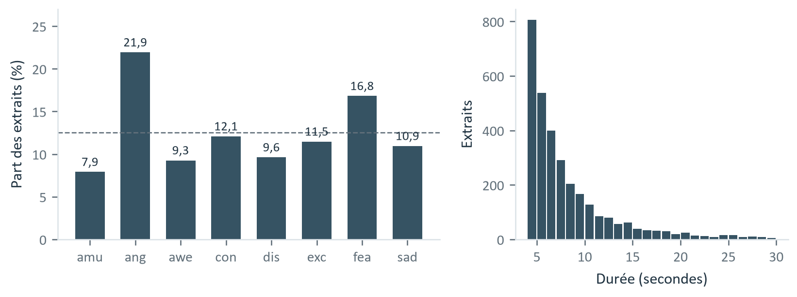

Les descriptions décrivent ce que l'on voit (par exemple « un homme aux cheveux roux, en chemise bleue,
devant un grillage »), rarement ce que l'on ressent. Un tiers des extraits n'a aucun dialogue anglais.

### 2.2 Une annotation surtout visuelle

D'après l'article EmoVid, environ 80 % des émotions ont été attribuées automatiquement par un modèle
vision-langage, NVILA-Lite-2B, qui ne voit que les images, puis contrôlées par des annotateurs. **Les
étiquettes reflètent donc surtout le contenu visuel.** Ce point explique une grande partie des résultats : la
vidéo sera la modalité la plus performante et l'audio la plus faible, non parce que le son ne porte pas
d'émotion, mais parce que l'étiquette a été décidée en regardant les images.

### 2.3 Déséquilibre des classes et choix de la mesure

La classe la plus fréquente (*anger*, 21,9 %) est près de trois fois plus représentée que la plus rare
(*amusement*, 7,9 %). Un modèle qui répondrait toujours *anger* aurait 22 % d'exactitude sans rien
comprendre. Nous mesurons donc les modèles avec le **F1 macro** :

- pour une émotion donnée, la **précision** répond à « quand le modèle dit *peur*, a-t-il raison ? » et le
  **rappel** à « parmi les vraies peurs, combien le modèle en retrouve-t-il ? » ;
- le **F1** combine les deux : F1 = 2 × précision × rappel / (précision + rappel). Par exemple, une précision
  de 0,75 et un rappel de 0,60 donnent un F1 de 0,67 ;
- le **F1 macro** est la moyenne des F1 des huit émotions : chaque émotion compte autant, quelle que soit sa
  fréquence. Le repère de hasard retenu dans le rapport est 0,125 ; répondre toujours *anger* donne environ 0,04.

Pendant l'apprentissage, les classes sont **pondérées** : chaque extrait reçoit un poids inversement
proportionnel à la fréquence de son émotion, pour que les émotions rares pèsent autant que les fréquentes.

### 2.4 Partition par film

Les extraits d'un même film partagent les acteurs, les décors, la lumière et la musique. Un modèle évalué sur
un film déjà vu pendant l'apprentissage pourrait reconnaître ces éléments au lieu de l'émotion, et serait
jugé trop favorablement. **La partition se fait donc par film** : aucun film n'est dans deux ensembles.

Chaque groupe a proposé une partition ; une seule a été retenue et est utilisée par tous les groupes. Ce
n'est pas celle de notre groupe, qui visait 12,5 % de chaque émotion en dev et en test. La partition retenue
garde au contraire les proportions du corpus dans chaque ensemble, à moins d'un demi-point près.

Tableau : Partition retenue (statistiques calculées par point2_partition/statistiques.py)
| | train | dev | test | total |
|---|---:|---:|---:|---:|
| Films | 250 | 50 | 50 | 350 |
| Extraits | 2 207 | 442 | 439 | 3 088 |
| amusement | 7,9 % | 7,9 % | 8,0 % | 7,9 % |
| anger | 21,9 % | 22,2 % | 21,9 % | 21,9 % |
| awe | 9,3 % | 9,0 % | 9,1 % | 9,3 % |
| contentment | 12,0 % | 12,2 % | 12,3 % | 12,1 % |
| disgust | 9,6 % | 9,7 % | 9,8 % | 9,6 % |
| excitement | 11,4 % | 11,5 % | 11,6 % | 11,5 % |
| fear | 16,8 % | 16,7 % | 16,9 % | 16,8 % |
| sadness | 11,1 % | 10,6 % | 10,5 % | 10,9 % |

### 2.5 Nettoyage : les écrans de fin publicitaires

Certains extraits se terminent par un écran de la chaîne Movieclips (bandeau gris à gauche, bouton bleu à
droite). Le script `point4_video/00_nettoyer_pub.py` les repère sans utiliser les étiquettes, en cherchant ces
motifs jusqu'à la dernière image : 33 extraits sont concernés. Pour chacun, il enregistre l'instant `fin_utile`
où l'écran commence ; les images comme le son sont arrêtés à cet instant dans tous les modules.

> **À retenir**
> 250 films et 2 207 extraits servent à apprendre. Les 50 films de dev et les 50 films de test restent séparés. Le F1 macro donne le même poids aux huit émotions.


## 3. Transcription des dialogues (point 3)

> **En bref**
> Deux systèmes de transcription indépendants se contrôlent. Des indices acoustiques et une séparation de la voix orientent les cas difficiles. Au total, 1 032 extraits ont été relus à l'écoute. Le corpus final contient 2 025 dialogues anglais.

Les dialogues ne sont pas fournis par le corpus. Il n'existe aucune transcription de référence pour nos
extraits, et seulement environ 4 heures de parole : entraîner un système de reconnaissance de la parole est
hors de portée. Nous utilisons donc des modèles de transcription pré-entraînés, tels quels, et tout le
travail porte sur le **contrôle de leur qualité** : repérer quand ils se trompent ou inventent du texte.

### 3.1 Premier essai : un seul modèle

Whisper `large-v3-turbo` a d'abord été appliqué seul, avec une détection de parole (Silero VAD, pour ne pas
transcrire les silences et la musique, sur lesquels Whisper invente parfois des phrases) et un filtrage des
segments douteux, sur l'audio brut et sur la voix isolée par Demucs, un modèle de séparation de sources.

Tableau : Premier essai de transcription sur les 3 088 extraits
| Traitement | Extraits avec parole | Mots par extrait parlé | Textes modifiés par rapport au brut |
|---|---:|---:|---:|
| Audio brut | 2 119 (68,6 %) | 14,9 | — |
| Voix isolée (Demucs) | 2 167 (70,2 %) | 14,8 | 1 332 (43,1 %) |
| Filtre passe-bande 300–3 400 Hz | mêmes textes (12 extraits testés) | — | — |

La séparation de la voix modifie 43 % des textes, mais sans référence on ne peut pas savoir lesquels sont
meilleurs : elle retrouve parfois un mot couvert par la musique et en déforme parfois un autre. Le filtre
fréquentiel ne sert à rien, la musique occupant la même bande que la voix. Conclusion : un seul modèle ne
permet pas de savoir quand il se trompe. Il faut un moyen de **contrôler** les transcriptions.

### 3.2 Chaîne retenue : deux modèles qui se contrôlent

L'idée est simple : **deux modèles de familles différentes ne font pas les mêmes erreurs**. Quand ils
écrivent le même texte et qu'on entend bien de la parole, le texte est très probablement juste ; quand ils
divergent, un humain tranche. La chaîne compte neuf scripts.

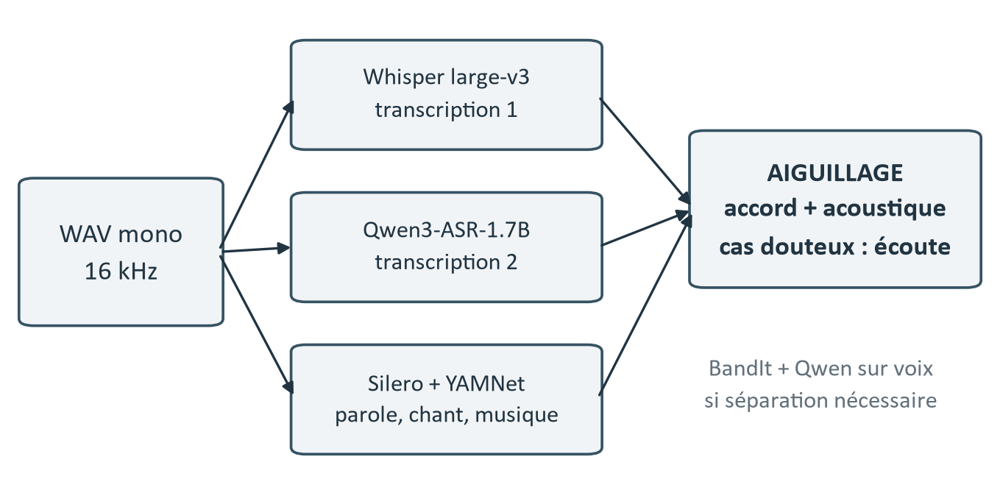

1. **Préparation** (`01`) : chaque MP3 est converti en WAV mono à 16 kHz.
2. **Deux transcriptions** (`02`), sur l'extrait complet :
   - **Whisper large-v3** (OpenAI), exécuté avec whisper.cpp : recherche en faisceau sur 5 hypothèses,
     température 0 (réponse la plus probable), seuil de non-parole 0,6 ;
   - **Qwen3-ASR-1.7B** (Alibaba), un modèle de transcription d'une autre famille, exécuté avec
     llama.cpp, température 0.
3. **Indices acoustiques** (`03`), qui ne transcrivent rien mais disent ce que l'on entend :
   - **Silero VAD** mesure la **part de l'extrait où quelqu'un parle** ;
   - **YAMNet**, un classifieur de 521 catégories de sons (AudioSet), donne par fenêtres d'une seconde la
     probabilité de **parole**, de **vocalisations** (cris, rires, pleurs), de **musique** et de **chant** ;
     on garde le pic de chaque groupe.
4. **Séparation pour les cas difficiles** (`04`) : quand les deux modèles ne suffisent pas à conclure
   (désaccord, musique, texte vide malgré de la parole), la voix est séparée du reste par **BandIt** (fenêtres
   de 8 s), puis **Qwen retranscrit la voix seule**. C'est un troisième avis. On mesure aussi l'énergie de la
   voix récupérée : si elle est quasi nulle, il n'y avait sans doute pas de parole. 1 568 extraits sont passés
   par cette étape.
5. **Aiguillage** (`05`) : des règles fixes classent chaque extrait en *texte accepté*, *pas de dialogue* ou
   *à vérifier* (figure suivante).
6. **Vérification à l'écoute** (`06`) : les extraits douteux sont ouverts dans Label Studio, avec la vidéo, le
   son d'origine, la voix séparée et les trois transcriptions ; l'humain choisit la bonne, la corrige ou
   indique qu'il n'y a pas de dialogue.
7. **Nettoyage et langue** (`07`) : normalisation des caractères, suppression des symboles de musique (♪),
   puis détection de la langue (langid, score ≥ 0,9 sur au moins 5 mots), confrontée aux langues annoncées
   par Whisper et Qwen. **Seul l'anglais est gardé**, car les modèles texte utilisés ensuite sont anglais ;
   un dialogue dans une autre langue est laissé vide.
8. **Export et corpus** (`08`, `09`) : la transcription finale est jointe à la partition, à l'émotion et à la
   description pour former `corpus.csv`.

### 3.3 Les règles d'aiguillage

Pour comparer deux transcriptions, on les ramène à une **liste de mots** (minuscules, sans ponctuation ; des
marqueurs comme « [music] » ou « silence » comptent comme un texte vide), puis on vérifie cinq conditions :

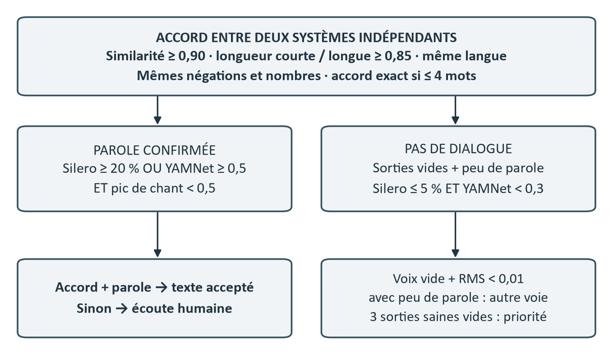

- la **similarité** des deux listes (part des mots communs dans le même ordre) est d'au moins 0,90 ;
- le **rapport de longueur**, texte court / texte long, est au moins égal à 0,85 ;
- les deux modèles annoncent la **même langue** ;
- elles contiennent exactement les **mêmes négations et les mêmes nombres** (*no*, *not*, *never*,
  *nothing*… et tous les chiffres) : une seule différence de ce type change le sens de la phrase ;
- pour une phrase de 4 mots ou moins, l'accord doit être **exact**.

La parole est **confirmée** si Silero détecte de la parole sur au moins 20 % de l'extrait ou si YAMNet donne
une probabilité de parole d'au moins 0,5, et si le pic de chant YAMNet reste inférieur à 0,5 (un texte chanté peut être une chanson, pas un dialogue). Un extrait est classé *pas de dialogue* si les transcriptions sont vides **et** que les
détecteurs entendent peu de parole (Silero ≤ 5 % et YAMNet < 0,3), ou, toujours avec peu de parole détectée, si la voix séparée est vide et si son rapport d'amplitude RMS au mélange est inférieur à 0,01. RMS désigne l'amplitude quadratique moyenne. Une règle prioritaire classe aussi « pas de dialogue » les trois sorties saines et strictement vides. Un accord original valide et soutenu par l'audio est prioritaire : une séparation moins bonne ne l'annule pas.

Tableau : Résultat de l'aiguillage (version finale des scripts)
| Sortie | Extraits | Détail |
|---|---:|---|
| Texte accepté | 1 267 | 1 237 où Whisper et Qwen concordent, 30 où Whisper et Qwen sur la voix séparée concordent |
| Pas de dialogue | 829 | modèles vides et peu de parole, ou voix séparée vide et sans énergie |
| À vérifier | 992 | principales raisons : pas de paire concordante (793), textes différents (724), longueurs différentes (401), négation ou nombre différent (188) |

### 3.4 Résultats

Tableau : Décisions prises à l'écoute et corpus final
| Résultat | Extraits |
|---|---:|
| Écoutés et tranchés à la main | 1 032 |
| dont texte de Qwen retenu | 690 |
| dont texte de Whisper retenu | 234 |
| dont pas de dialogue | 63 |
| dont texte de Qwen sur la voix séparée | 28 |
| dont texte corrigé à la main | 17 |
| Avec dialogue anglais (corpus final) | 2 025 (66 %) |
| Sans dialogue | 994 |
| Autre langue ou incertain | 69 |

Parmi les décisions humaines, le texte de Qwen a été retenu environ trois fois plus souvent que celui de Whisper (690 contre 234). Les 992 cas du routage final et les 1 032 décisions humaines correspondent à deux comptages distincts ; leur différence ne constitue pas une mesure d'erreur. Le résultat, `point3_transcription/resultats/corpus.csv`, réunit pour chaque extrait la
partition, l'émotion, la description, le dialogue, un indicateur « dialogue présent », la langue et la
durée. C'est l'entrée commune de tous les modèles du point 4. Depuis le dépôt, il se reconstruit à
l'identique à partir des décisions enregistrées (`07` à `09`, quelques secondes).

### 3.5 Limites

Les extraits non relus à la main (2 056, avec ou sans dialogue) peuvent contenir des erreurs, même quand deux modèles
concordent ; aucun taux d'erreur sur les mots n'a été mesuré, faute de référence indépendante. Les cris,
rires et pleurs ne sont pas des mots et ne sont pas transcrits, alors qu'ils portent beaucoup d'émotion :
c'est le rôle du modèle audio de les capter.

> **À retenir**
> L'accord entre systèmes sert à trier les cas, sans garantir une transcription parfaite. Les seuils sont fixes ; les désaccords passent par l'écoute humaine. Aucun taux d'erreur lexical indépendant n'est disponible.


## 4. Protocole commun des modèles

> **En bref**
> Tous les réglages sont choisis sur train par validation croisée à cinq plis, groupés par film. Chaque prédiction hors pli vient d'un modèle qui n'a jamais vu le film. Dev ne sert qu'à mesurer. Les modèles d'émotion utilisent les vecteurs des encodeurs.

Cette partie décrit la méthode suivie par les trois modalités et par la fusion. Elle est commune à tout le
projet : c'est elle qui rend les scores comparables et qui permet de fusionner proprement.

### 4.1 Trois ensembles, trois rôles

- **train** (250 films, 2 207 extraits) : sert à **apprendre** les modèles et à **faire tous les choix**
  (réglages, couches, nombre de modèles combinés, poids de la fusion), par validation croisée.
- **dev** (50 films, 442 extraits) : sert **uniquement à mesurer** les modèles retenus. Aucun choix n'y est
  fait.
- **test** (50 films, 439 extraits) : utilisé **une seule fois**, à la toute fin, pour le système final.

Pourquoi ne pas choisir les réglages sur dev ? Parce que 50 films, c'est peu : en essayant des dizaines de
réglages et en gardant le meilleur sur dev, on garde souvent celui qui a eu de la chance sur ces 50 films.
Le module texte l'a mesuré : réglé en regardant dev, son système N2 affichait 0,405 sur dev ; réglé
proprement en validation croisée, 0,366. Les 4 points d'écart n'étaient que de la chance.

### 4.2 La validation croisée par film

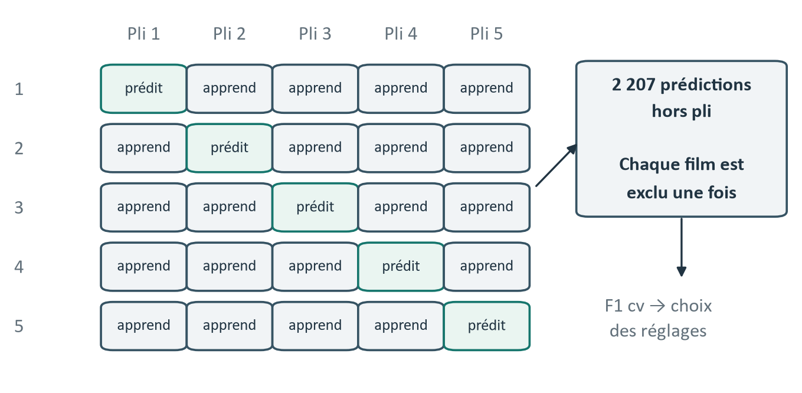

1. Les 250 films de train sont répartis en **5 paquets** d'environ 50 films (environ 440 extraits chacun),
   avec `GroupKFold` de scikit-learn, qui ne fait pas de tirage au hasard : les paquets sont **les mêmes dans
   les trois modalités** (même `corpus.csv`, même ordre).
2. **Tour 1** : on apprend un modèle sur les paquets 2 à 5, puis il prédit les extraits du paquet 1.
   **Tour 2** : un nouveau modèle apprend sur les paquets 1, 3, 4 et 5, puis prédit le paquet 2. Et ainsi de
   suite jusqu'au tour 5.
3. À la fin, **chacun des 2 207 extraits a été prédit exactement une fois**, par un modèle qui n'avait jamais
   vu son film.

À chaque tour, tout ce qui s'apprend est réappris sur les quatre paquets d'apprentissage seulement :
la standardisation des variables (moyenne et écart-type), le classifieur, le TF-IDF du texte.

### 4.3 Les prédictions hors pli et le F1 cv

Les prédictions obtenues à l'étape 3 s'appellent les **prédictions hors pli** (un « pli » est un paquet). Pour
chaque extrait de train, ce sont les huit probabilités données par le modèle du tour où son paquet était mis
de côté. Elles servent à trois choses :

- calculer le **F1 cv** : on compare ces 2 207 prédictions aux vraies émotions et on calcule le F1 macro.
  C'est le chiffre « F1 cv » des tableaux de ce rapport ;
- choisir les réglages (paragraphe suivant) ;
- apprendre les **combinaisons** de modèles et la **fusion** sans toucher à dev.

Une variante est utilisée pendant la recherche des réglages : on calcule un F1 macro sur chacun des cinq
paquets, puis la moyenne des cinq. Les deux calculs donnent presque le même nombre (par exemple 0,209 et
0,212 pour le N1 audio), mais pas exactement, car le F1 n'est pas une somme : la moyenne de cinq F1 n'est pas
le F1 de l'ensemble. Cela explique quelques écarts au millième près entre certains tableaux des README.

### 4.4 Comment on choisit un réglage

Pour comparer deux réglages (par exemple deux couches d'un encodeur, ou deux valeurs de régularisation), on
fait passer chacun par la validation croisée complète et on garde celui qui a le meilleur F1 cv. Deux outils
sont utilisés :

- la **recherche sur grille** (`GridSearchCV`) quand il y a peu de valeurs à essayer (par exemple 9 valeurs de
  C × avec ou sans pondération des classes) ;
- **Optuna**, quand il y a beaucoup de réglages continus (taille d'un réseau, taux d'apprentissage, dropout : mise à zéro aléatoire de neurones…) :
  il propose un réglage, la validation croisée le note, et il s'en sert pour proposer le suivant. Nous lui
  accordons 30 essais (25 pour les SVM de la vidéo, 20 pour ceux de l'audio).

Comme les réglages sont choisis en regardant ces mêmes prédictions hors pli, le F1 cv du réglage retenu est
légèrement optimiste. C'est pourquoi on contrôle ensuite sur dev, qui n'a servi à rien.

### 4.5 Le modèle final et la mesure sur dev

Une fois le réglage choisi, on apprend un **modèle final** avec ce réglage sur **les 250 films de train**. Ce
modèle prédit dev (F1 dev) et test. On n'utilise jamais ses prédictions de train pour l'évaluation : il a appris sur ces extraits,
son score y serait faussement excellent. Chaque modèle enregistre donc deux sortes de prédictions, toutes
deux « honnêtes », dans un fichier `resultats/probas_<modèle>.npz` :

Tableau : Contenu d'un fichier de probabilités
| Champ | Contenu | Produit par |
|---|---|---|
| `probabilites_hors_pli` | 8 probabilités pour chaque extrait de train (NaN ailleurs) | les 5 modèles de la validation croisée |
| `probabilites` | 8 probabilités pour les 3 088 extraits ; seules celles de dev et test sont utilisées | le modèle final appris sur tout train |
| `video_id`, `partition`, `emotions` | identifiants, ensemble, ordre des 8 émotions | — |

### 4.6 Intervalles de confiance par films

Pour savoir si une différence de score entre deux systèmes est réelle, nous rééchantillonnons les films :
2 000 fois, on tire 50 films avec remise parmi ceux de dev, on recalcule la différence de F1 macro, et on
garde l'intervalle qui contient 95 % des différences. Si cet intervalle ne contient pas 0, le gain est
significatif. On tire les **films** et non les extraits, parce que les extraits d'un même film se ressemblent
et ne sont pas des observations indépendantes.

### 4.7 Les trois niveaux de méthodes et la combinaison

Chaque modalité suit le même parcours :

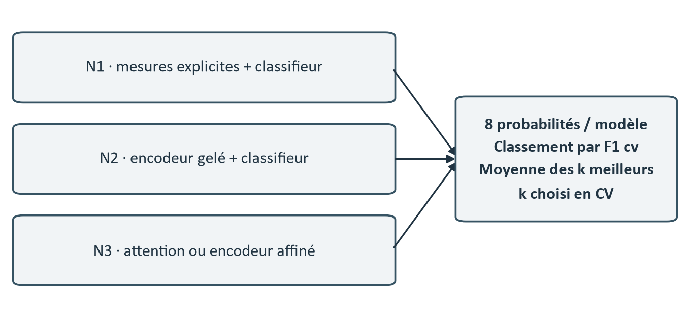

- **N1 — descripteurs classiques** : des mesures calculées « à la main » (TF-IDF pour le texte, couleurs pour
  la vidéo, descripteurs acoustiques pour le son), suivies d'une régression logistique ;
- **N2 — encodeurs pré-entraînés gelés** : un modèle pré-entraîné, déjà appris sur de grandes quantités de données, transforme l'extrait en vecteur ; seul un classifieur posé sur ce vecteur est appris ;
- **N3 — une partie apprise en plus** : soit une **tête d'attention** qui apprend à pondérer les moments ou
  les images de l'extrait (audio, vidéo), soit le **fine-tuning** du modèle entier (texte) ;
- **combinaison** : on fait la moyenne des probabilités des *k* meilleurs modèles.

La combinaison fonctionne ainsi :

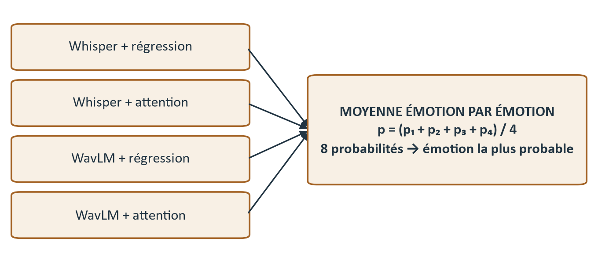

1. chaque modèle donne 8 probabilités par extrait ;
2. on classe tous les modèles de la modalité par F1 cv, du meilleur au moins bon ;
4. pour k = 1, 2, 3…, on fait la moyenne des probabilités des k premiers, émotion par émotion, et on retient
   pour chaque extrait l'émotion de plus forte probabilité moyenne ;
4. on calcule le F1 cv de chaque moyenne (sur les prédictions hors pli) et on garde le meilleur k.

Une moyenne n'a aucun paramètre à apprendre : seul k est choisi. Elle fonctionne parce que des modèles
différents ne se trompent pas sur les mêmes extraits ; leurs erreurs se compensent en partie.

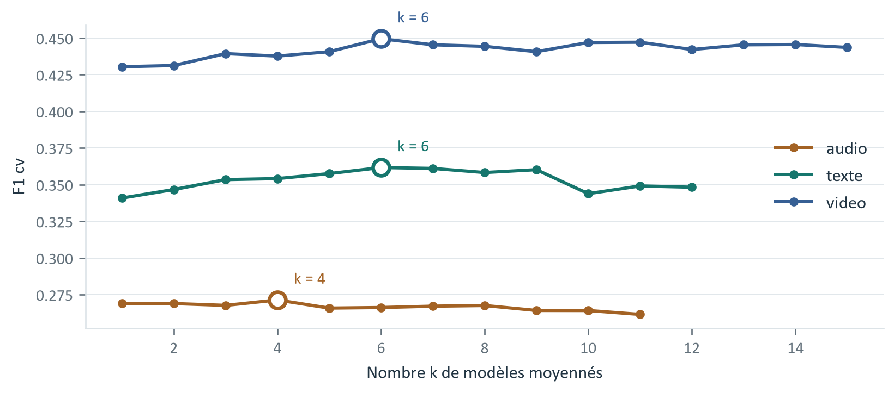

### 4.8 Encodeurs et vecteurs : le vocabulaire

Les modèles pré-entraînés utilisés dans ce projet sont des réseaux de type Transformer. Trois notions sont
utiles pour la suite.

- **Encodeur.** Un encodeur lit du son, une image ou du texte et produit des vecteurs, c'est-à-dire des listes de valeurs qui résument l'entrée. Pour la **classification des émotions** (points 4 et 5), seuls les encodeurs sont utilisés : **aucun décodeur n'est utilisé**. La transcription du point 3 constitue une étape distincte de préparation des dialogues.
- **Gelé.** Un encodeur gelé n'est jamais modifié : ses poids restent ceux du pré-entraînement, il ne voit
  aucune étiquette d'émotion, et il ne tourne qu'**une seule fois** sur les 3 088 extraits. Ses vecteurs sont
  enregistrés sur disque, puis redistribués dans les plis de la validation croisée. Passer dev et test dans
  un encodeur gelé dès le début n'est donc pas une fuite d'information : c'est une traduction fixe des
  données en vecteurs.
- **Couches.** Un encodeur est une **pile de couches** : chacune transforme les vecteurs de la précédente.
  On peut lire les vecteurs produits par n'importe quelle couche, pas seulement la dernière. Les premières couches restent proches du signal brut ; les dernières se spécialisent dans la tâche d'origine du modèle
  (pour Whisper, transcrire). Nous utilisons les **vecteurs** (les sorties) des couches, jamais leurs
  **poids** (les paramètres internes).

> **À retenir**
> F1 cv pour choisir, dev pour contrôler, test pour l'évaluation finale. Standardisation, vocabulaire et classifieurs sont appris dans chaque pli. Les prédictions hors pli rendent possible une fusion sans réglage sur dev.


## 5. Modèle audio (point 4)

> **En bref**
> Le son devient d'abord 221 descripteurs, puis des vecteurs d'encodeurs gelés. Une tête d'attention peut pondérer 16 tranches temporelles. Quatre modèles sont finalement moyennés. Le système obtient 0,271 en F1 cv et 0,270 sur dev.

### 5.1 Préparation du son

Pour tous les niveaux, le MP3 stéréo (44,1 kHz) est converti en **mono à 16 000 échantillons par seconde**
(48 000 pour CLAP), arrêté avant l'écran de fin publicitaire et coupé à 30 secondes au plus. On obtient une
**forme d'onde** : une suite de nombres qui décrit la pression de l'air au cours du temps.

### 5.2 N1 : descripteurs acoustiques et régression logistique

#### Ce que sont les descripteurs

Un **descripteur** est une mesure calculée directement sur le son, par une formule connue, sans
apprentissage. Ils décrivent la voix (hauteur, intensité, qualité), le timbre et la musique. Nous en
calculons deux familles.

**eGeMAPS** (*extended Geneva Minimalistic Acoustic Parameter Set*, Eyben et al., 2016), calculé avec
l'outil openSMILE. C'est un jeu de référence volontairement **petit**, conçu par des chercheurs en émotion
vocale pour que les études soient comparables. Il donne **88 valeurs** par extrait :

- le son est découpé en **trames** très courtes (20 à 60 ms), une toutes les 10 ms ;
- sur chaque trame, openSMILE mesure **25 descripteurs de bas niveau**. Fréquence : hauteur de la voix (F0),
  jitter (micro-variations de hauteur), fréquences et largeurs des formants F1 à F3 (résonances de la bouche
  et de la gorge). Énergie : intensité perçue, shimmer (micro-variations d'intensité), rapport harmoniques sur
  bruit (HNR, voix claire ou soufflée). Spectre : pentes du spectre, *alpha ratio* et indice de Hammarberg
  (répartition de l'énergie entre graves et aigus), différences d'harmoniques H1-H2 et H1-A3 (tension de la
  voix), MFCC 1 à 4, flux spectral ;
- chaque descripteur est ensuite **résumé sur tout l'extrait** : moyenne et coefficient de variation pour
  tous, et pour la hauteur et l'intensité aussi les centiles 20, 50 et 80, l'écart entre centiles et la vitesse
  des montées et des descentes ;
- s'y ajoutent des mesures de **rythme** : nombre de pics d'intensité par seconde, nombre et durée des
  segments voisés (où la voix vibre) et des pauses.

**librosa**, une bibliothèque Python d'analyse audio, complète eGeMAPS avec des mesures plus générales, qui
décrivent aussi la musique et les bruits : 20 **MFCC** (coefficients qui résument la forme du spectre, donc le
« timbre ») et leurs **dérivées** (comment le timbre change), 12 **chroma** (l'énergie de chacune des 12
notes de la gamme), 7 bandes de **contraste spectral** (pics contre creux du spectre), le **centroïde** (son
clair ou sourd), la largeur de bande, le *rolloff*, la **platitude** (bruit ou son tonal), l'**énergie**, le
taux de **passages par zéro** (son bruité ou aigu) et la force des **attaques** (chocs, coups). Pour chacune,
on garde la moyenne et l'écart-type dans le temps, plus le **tempo**.

Tableau : Composition des 221 descripteurs du N1 audio
| Bloc | Détail | Nombre |
|---|---|---:|
| eGeMAPS | 25 descripteurs par trame résumés sur l'extrait, et rythme | 88 |
| MFCC | 20 coefficients × (moyenne, écart-type) | 40 |
| Dérivées des MFCC | 20 × 2 | 40 |
| Chroma | 12 notes × 2 | 24 |
| Contraste spectral | 7 bandes × 2 | 14 |
| Centroïde, largeur de bande, rolloff, platitude | 4 × 2 | 8 |
| Énergie, passages par zéro, attaques | 3 × 2 | 6 |
| Tempo | battements par minute | 1 |
| **Total** | | **221** |

Un mot sur un chiffre parfois cité : eGeMAPS ne contient pas « plusieurs milliers » de descripteurs. Le grand
jeu d'openSMILE, ComParE 2016, en compte 6 373. Avant le résumé, on dispose aussi d'environ 16 000 valeurs
pour un extrait de 6,5 s (25 descripteurs × 650 trames). Nous utilisons le jeu résumé de 88 valeurs, adapté
à nos 2 207 exemples : 6 373 variables pour 2 207 extraits mèneraient tout droit au surapprentissage.

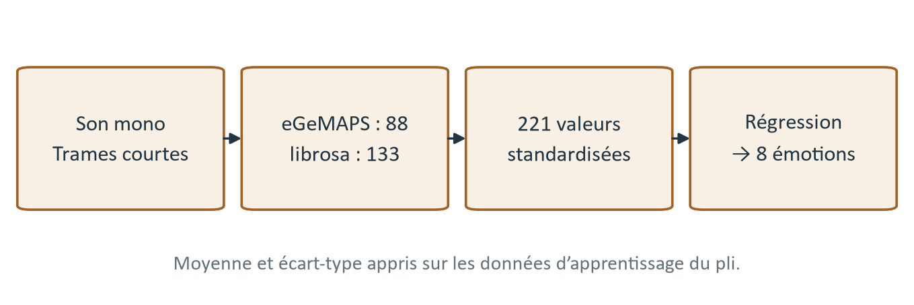

#### Comment la régression logistique les utilise

1. **Standardisation** : chacun des 221 descripteurs est centré et réduit (moyenne 0, écart-type 1), avec la
   moyenne et l'écart-type calculés sur les extraits d'apprentissage. Sans cela, un descripteur exprimé en
   hertz (des centaines) écraserait un descripteur compris entre 0 et 1.
2. **Un score par émotion** : pour chaque émotion e, le modèle calcule
   score(e) = b(e) + w(e,1) × x1 + w(e,2) × x2 + … + w(e,221) × x221, où x1 à x221 sont les descripteurs
   standardisés. Il y a donc un poids w par descripteur **et par émotion** : 221 × 8 poids + 8 biais, soit
   1 776 paramètres.
3. **Des probabilités** : la fonction *softmax* transforme les 8 scores en 8 probabilités positives qui font
   1 au total. L'émotion prédite est celle de plus forte probabilité.
4. **L'apprentissage** cherche les poids qui donnent une forte probabilité à la vraie émotion (entropie
   croisée), avec deux réglages choisis en validation croisée :
   - **C**, l'inverse de la force de la régularisation : un petit C pousse les poids vers 0, ce qui limite le
     surapprentissage. C est essayé parmi 9 valeurs, de 0,0001 à 1 ;
   - la **pondération des classes** (avec ou sans).

Réglage retenu : **C = 0,003** (régularisation forte), classes pondérées. Résultat : **F1 cv 0,212, F1 dev
0,224**, exactitude dev 22,6 %. C'est mieux que le hasard (0,125), mais modeste.

#### Quels descripteurs contribuent à la prédiction ?

Nous avons mesuré l'importance de chaque **famille** de descripteurs par permutation, en validation croisée.
Dans chaque pli, on mélange au hasard les valeurs d'une famille entre les extraits du paquet prédit (ce qui
« brouille » l'information de la famille sans changer sa distribution), puis on mesure la baisse du F1 macro.
Plus la baisse est forte, plus le modèle utilisait cette famille.

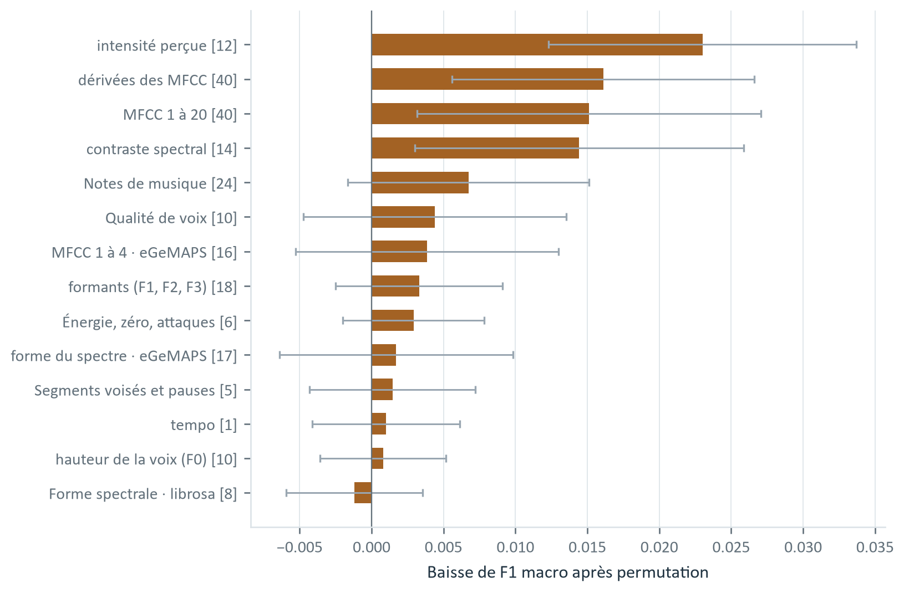

- **L'intensité perçue** (volume de la voix et du son, ses variations, pics d'intensité par seconde) est la
  famille la plus utile : la brouiller fait perdre 0,023 de F1, soit plus de 10 % du score du N1.
- Viennent ensuite le **timbre** : MFCC, leurs dérivées et le contraste spectral. Ces descripteurs captent
  l'ensemble du son (voix, musique, bruitages), ce qui est logique pour des scènes de film.
- La **hauteur de la voix** (F0), pourtant classique en émotion vocale, n'apporte presque rien ici : dans les
  films, la voix est souvent couverte par la musique et les effets, et un tiers des extraits n'a pas de dialogue.

Les coefficients du modèle appris sur tout train confirment cette image. Les descripteurs aux poids moyens
les plus forts (en valeur absolue, toutes émotions confondues) sont la moyenne du premier MFCC (l'énergie
globale du spectre), une dérivée de MFCC, le nombre de **pics d'intensité par seconde** (le débit, les
syllabes, les chocs), le contraste spectral des graves, et deux mesures de **qualité de voix** (variabilité du
jitter et de la différence H1-A3). Par émotion, les poids les plus positifs sont parlants : l'**intensité
médiane** pour *amusement*, la **variabilité des descentes d'intensité** pour *excitement*, le **flux
spectral des parties non voisées** (bruits, souffles) pour *fear*, et les **pics d'intensité** pour *awe*.

Une précision s'impose : les descripteurs d'une même famille sont corrélés entre eux, et la régularisation
répartit les poids entre descripteurs voisins. Il faut donc lire les poids individuels avec prudence ;
l'importance par famille, mesurée par permutation, est plus fiable. Les tableaux complets sont dans
`figures/importance_familles_n1.csv` et `descripteurs_principaux_n1.csv`.

### 5.3 N2 : encodeurs pré-entraînés gelés

#### Les cinq encodeurs

Tableau : Les cinq encodeurs audio comparés en N2
| Encodeur | Pré-entraînement | Entrée | Couches | Taille des vecteurs |
|---|---|---|---:|---:|
| Whisper large-v3 (OpenAI), encodeur seul | transcription de parole multilingue (millions d'heures) | spectrogramme log-mel, 128 bandes | 32 | 1 280 |
| WavLM large (Microsoft) | parole, auto-supervisé | forme d'onde brute | 24 | 1 024 |
| wav2vec2 émotion (audEERING) | parole, affiné sur valence, éveil, dominance | forme d'onde brute | 12 | 1 024 |
| AST (MIT) | 527 catégories de sons d'AudioSet | spectrogramme, fenêtres de 10 s | 12 | 768 |
| CLAP (LAION), branche audio | association son-texte, musique et parole | son à 48 kHz, fenêtres de 10 s | vecteur final | 512 |

Les cinq couvrent trois façons de « comprendre » le son : la parole (Whisper, WavLM), l'émotion dans la
voix (wav2vec2 émotion) et les sons et la musique (AST, CLAP). Un sixième, MERT (musique), a été écarté
parce qu'il exige d'exécuter du code téléchargé.

#### Ce que l'on prend de chaque modèle

Nous n'utilisons que la **partie encodeur** de chaque modèle :

- **Whisper** : son **décodeur n'est pas utilisé** pour classer les émotions.
  On garde seulement l'encodeur, qui transforme le son en vecteurs ;
- **WavLM et wav2vec2** sont chargés sans leur tête finale : seulement la pile de couches ;
- **AST** : on lit les couches de son encodeur ; sa tête de classification ne sert qu'à produire les 527
  probabilités AudioSet, testées à part comme descripteurs ;
- **CLAP** : seulement la branche audio, qui donne un vecteur final par fenêtre de 10 s.

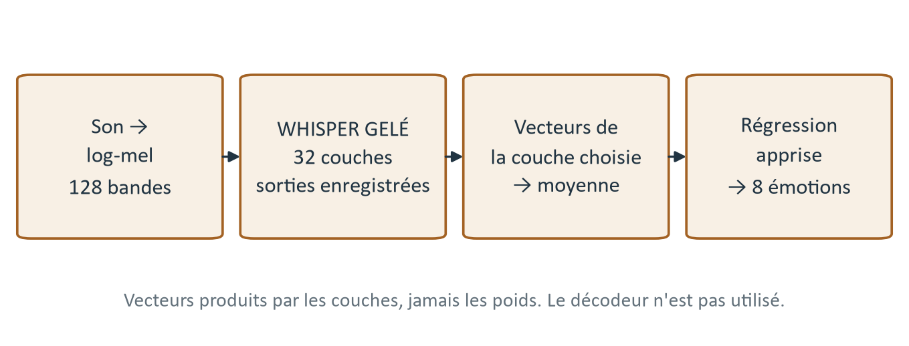

#### Du son au vecteur, couche par couche

1. Le son est préparé comme le demande chaque modèle (spectrogramme log-mel pour Whisper et AST, forme
   d'onde normalisée pour WavLM et wav2vec2).
2. Il traverse l'encodeur **une seule fois**, sur la carte graphique, en demandant la sortie de **toutes** les
   couches (*hidden states*). Chaque couche rend une suite de vecteurs dans le temps : pour Whisper, un
   vecteur de 1 280 valeurs toutes les 20 ms, soit environ 325 vecteurs pour un extrait de 6,5 s.
3. Pour chaque couche, cette suite est résumée par sa **moyenne**, seule ou complétée par son **écart-type**, dans le temps : un vecteur par couche et par extrait.
4. Tout est enregistré sur disque (`couches_whisper.npy` : 3 088 extraits × 33 sorties de couche × 2 560
   valeurs). Ce calcul a pris 12,8 minutes pour Whisper.
5. **Ensuite seulement**, avec les étiquettes, on donne les vecteurs d'une couche à un classifieur, évalué en
   validation croisée.

#### Les 76 configurations

Pour chaque encodeur, on avance **étape par étape**, en gardant à chaque étape le meilleur choix en F1 cv :

Tableau : Les étapes de la recherche du N2 audio
| Étape | Question | Ce qu'on essaie | Classifieur | Configurations par encodeur |
|---|---|---|---|---:|
| A1 | Quelle couche ? | 7 couches réparties de la première à la dernière + la moyenne de toutes les couches | régression logistique | 8 |
| A2 | Quel résumé dans le temps ? | moyenne + écart-type (la moyenne seule est déjà en A1) | régression logistique | 1 |
| B | Ajouter des descripteurs ? | N1, probabilités AudioSet, les deux | régression logistique | 3 |
| D | Un autre classifieur ? | analyse discriminante (LDA, séparation statistique des classes) et SVM (classifieur à marge maximale), sur « sans ajout » et sur le meilleur ajout | LDA, SVM | 4 |

Cela fait 16 configurations pour chacun des quatre encodeurs à couches (64), 9 pour CLAP (pas de couches :
A2, B et D), et 3 pour les probabilités AudioSet seules (régression logistique, LDA, SVM) : **76** au total.
Chaque configuration contient elle-même une recherche de réglages en validation croisée (C pour la régression
logistique, 20 essais Optuna pour le SVM), soit plusieurs centaines d'apprentissages. Le détail figure en
annexe B.

Tableau : Meilleure configuration de chaque encodeur (F1 cv : moyenne par pli)
| Sortie retenue | Couche | Ajout | Classifieur | F1 cv | F1 dev |
|---|---|---|---|---:|---:|
| Whisper | 16 sur 32 | — | régression logistique | **0,265** | 0,267 |
| WavLM | moyenne des couches | N1 | régression logistique | 0,256 | 0,240 |
| wav2vec2 émotion | moyenne des couches (+ écart-type) | N1 + AudioSet | régression logistique | 0,249 | 0,263 |
| CLAP | — | — | régression logistique | 0,245 | 0,229 |
| AST | 4 sur 12 | — | régression logistique | 0,241 | 0,219 |
| AudioSet seul | — | — | régression logistique | 0,213 | 0,214 |

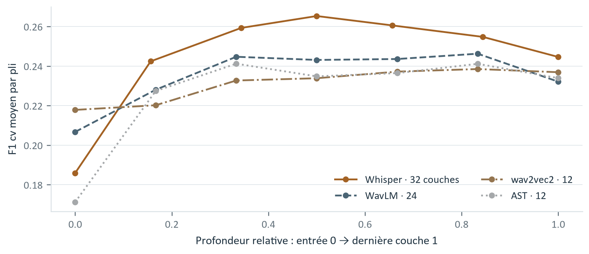

Ce que l'on retient :

- **Les couches du milieu sont les plus utiles.** Pour Whisper : 0,186 pour l'entrée (couche 0), 0,242 pour
  la couche 5, 0,265 pour la couche 16, puis 0,245 pour la dernière. Whisper a été entraîné à transcrire : ses
  dernières couches ne gardent que ce qui sert à écrire les mots et « oublient » le ton de la voix, alors que
  l'émotion est justement dans le ton. Même phénomène pour AST, dont la meilleure couche est la 4 sur 12.
- **Les modèles de parole dépassent les modèles de sons et de musique**, et même le modèle affiné sur
  l'émotion vocale ne bat pas Whisper : il a été entraîné sur des voix enregistrées en studio, avec d'autres
  catégories.
- **La régression logistique est la meilleure partout** ; le SVM tombe à 0,16–0,20 une fois calibré pour
  donner des probabilités.
- **Ajouter les descripteurs N1 ou AudioSet n'apporte presque rien** une fois un encodeur utilisé.

### 5.4 N3 : tête d'attention sur 16 tranches de temps

En N2, tout l'extrait est résumé par une moyenne. En N3, on garde **16 tranches de temps** de même durée, et
un petit réseau apprend lesquelles comptent le plus (par exemple un cri au milieu d'une scène).

Pour chaque tranche, l'entrée est le vecteur de l'encodeur gelé, moyenné sur toutes ses couches et sur la
durée de la tranche (1 280 valeurs pour Whisper). La tête comporte trois couches apprises :

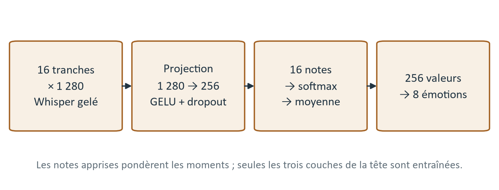

1. une **couche cachée**, la même pour les 16 tranches : 1 280 → 256 neurones, activation GELU (transformation non linéaire), dropout (mise à zéro aléatoire de neurones pendant l'apprentissage) ;
2. un **neurone de score** (256 → 1) qui note l'importance de chaque tranche ; un *softmax* transforme les
   16 notes en 16 poids qui font 100 % ;
3. après la **moyenne pondérée** des 16 vecteurs de 256 valeurs, une **couche de sortie** de 8 neurones
   (256 → 8), une par émotion.

```
pour chaque tranche t :  z(t) = dropout(GELU(W1 · x(t) + b1))        (256 valeurs)
                         s(t) = w2 · z(t) + b2                        (une note)
poids :                  a(t) = exp(s(t)) / somme des exp(s)          (16 poids, total 1)
résumé :                 h    = somme sur t de a(t) × z(t)            (256 valeurs)
sortie :                 p    = softmax(W3 · dropout(h) + b3)         (8 probabilités)
```

Cela représente environ **330 000 paramètres** pour Whisper (1 280 × 256 + 256, plus 257, plus 256 × 8 + 8),
contre environ 10 000 pour la régression logistique du N2. **Apprentissage** : entropie croisée pondérée
par classe, optimiseur AdamW (algorithme de mise à jour des poids), lots de 64 extraits, nombre d'époques fixé (une époque est un passage sur les données ; pas d'arrêt précoce, pour ne pas
utiliser le pli de validation pendant l'apprentissage). À chaque lot, une partie des tranches est retirée au
hasard, pour que le réseau ne dépende pas d'un seul moment. **Réglages** : 30 essais Optuna, chacun évalué en
validation croisée, sur la taille de la couche cachée (128, 256 ou 512), le dropout (0,1 à 0,6), le taux
d'apprentissage (1e-4 à 3e-3), la régularisation des poids (1e-4 à 0,1), le nombre d'époques (5 à 40) et la
part de tranches retirées (0 à 50 %). Le réglage retenu est ensuite réappris avec 3 graines aléatoires, dont
on moyenne les probabilités. Pour Whisper : 256 neurones, dropout 0,54, taux d'apprentissage 1,2e-4,
31 époques, 20 % des tranches retirées.

Tableau : N2 contre N3 pour chaque encodeur (F1 cv : moyenne des cinq plis)
| Encodeur | N2 (F1 cv) | N3 attention (F1 cv) | N3 (F1 dev) |
|---|---:|---:|---:|
| Whisper | **0,265** | 0,258 | 0,268 |
| WavLM | 0,256 | **0,258** | 0,255 |
| wav2vec2 émotion | **0,249** | 0,242 | 0,265 |
| AST | **0,241** | 0,235 | 0,243 |

L'attention ne bat pas la simple moyenne : les extraits sont courts (6,5 s en médiane, donc des tranches
d'environ 0,4 s), il y a peu de moments à « choisir », et 2 207 exemples suffisent mal à apprendre 30 fois
plus de paramètres qu'en N2. Mais les têtes d'attention ne se trompent pas sur les mêmes extraits que les
régressions logistiques : elles sont utiles à la combinaison.

### 5.5 Système audio final : combinaison de quatre modèles

Les 11 sorties audio (N1, six en N2, quatre en N3) sont classées par F1 cv, puis on fait la moyenne des
probabilités des k meilleures (partie 4.7).

Tableau : F1 cv de la moyenne des k meilleurs modèles audio
| k | 1 | 2 | 3 | **4** | 6 | 8 | 11 |
|---|---:|---:|---:|---:|---:|---:|---:|
| F1 cv | 0,269 | 0,269 | 0,268 | **0,271** | 0,266 | 0,268 | 0,261 |

Le système audio final est la **moyenne des probabilités de quatre modèles** : Whisper en N2 (couche 16 +
régression logistique), Whisper en N3 (attention), WavLM en N2 et WavLM en N3. Pour chaque extrait, l'émotion
retenue est celle de plus forte probabilité moyenne. **F1 cv 0,271, F1 dev 0,270**, exactitude dev 28,5 %. Le gain sur Whisper seul n'est pas significatif (intervalle de confiance par films
[−0,022 ; +0,028]) ; la combinaison stabilise surtout le résultat.

Une première version de l'audio (AST + N1 + SVM) affichait 0,269 sur dev, mais avec des réglages choisis sur
dev et sans prédictions hors pli. Elle a été refaite avec le protocole commun : le score est équivalent, mais
il est mesuré honnêtement et utilisable pour la fusion.

### 5.6 Matrices de confusion de l'audio

Les scores inscrits dans les matrices utilisent les prédictions hors pli regroupées : Whisper N2 donne 0,269 et Whisper N3 0,264. Les tableaux de recherche donnent la moyenne des cinq plis (0,265 et 0,258). Ce sont deux calculs du F1, définis au chapitre 4, sur les mêmes sorties. Abréviations communes : amu (amusement), ang (colère), awe (émerveillement), con (satisfaction), dis (dégoût), exc (excitation), fea (peur), sad (tristesse).

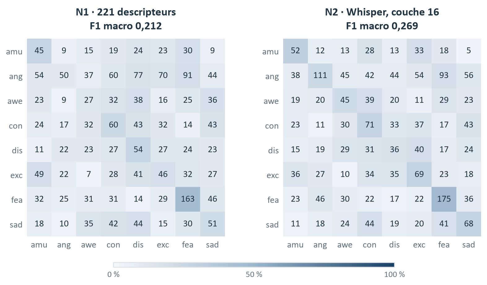

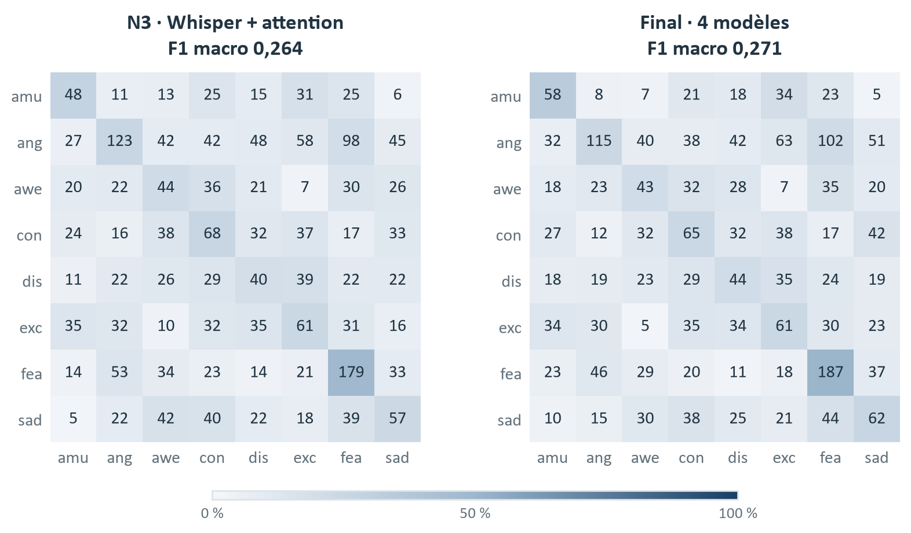

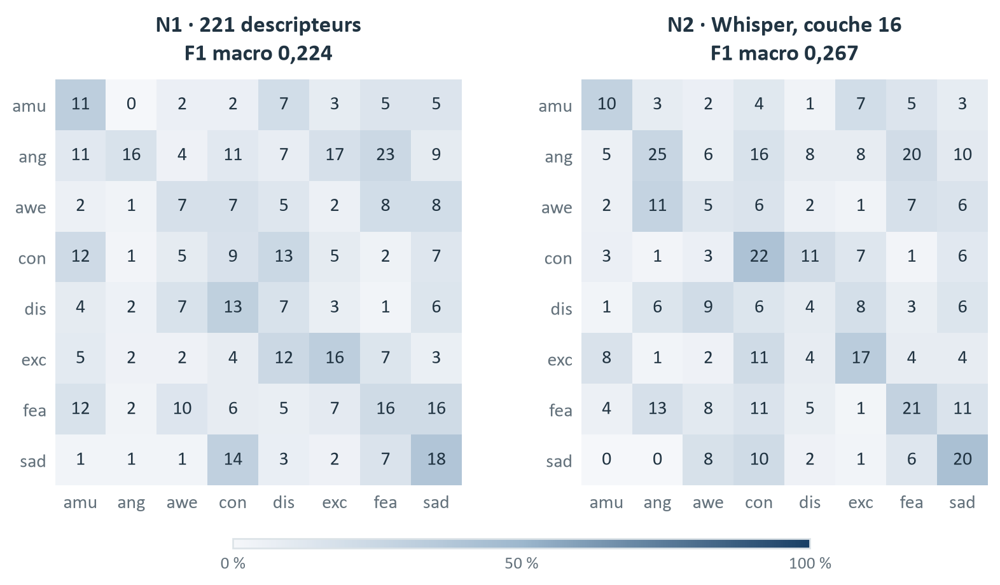

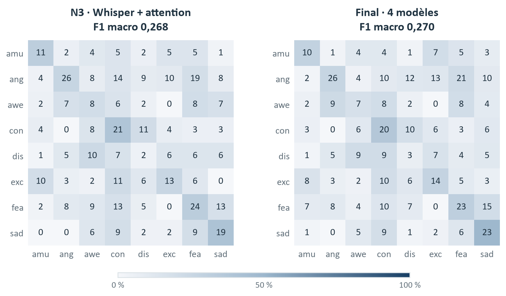

Comment les lire : chaque ligne correspond à une émotion réelle, chaque colonne à l'émotion prédite. La
diagonale contient les bonnes réponses. Par exemple, en validation croisée, le système final reconnaît 187
extraits de peur sur 371, mais en prend 102 de colère pour de la peur. Les matrices montrent que l'audio
reconnaît le mieux **la peur et la tristesse** (cris, musique angoissante ou mélancolique) et qu'il confond
souvent **la colère avec la peur** : deux émotions « fortes » qui se ressemblent à l'oreille. Le **dégoût**
et l'**émerveillement** sont presque invisibles dans le son. Le passage de N1 à N2 se voit nettement sur la
diagonale, puis la combinaison renforce surtout la peur et la tristesse.

> **À retenir**
> Whisper et WavLM, chacun avec régression logistique et attention, forment le système final. L'intensité et le timbre contribuent davantage que la hauteur vocale. L'audio capte surtout la peur et la tristesse.


## 6. Modèle texte (point 4)

> **En bref**
> Description et dialogue sont étudiés séparément puis ensemble. Le TF-IDF sert de référence ; les encodeurs apportent le contexte des mots. Le fine-tuning ajuste ensuite l'encodeur à la tâche. Six modèles combinés atteignent 0,362 en F1 cv et 0,387 sur dev.

### 6.1 Entrée

L'entrée est la **description** de la scène (fournie avec le corpus) et le **dialogue** transcrit au point 3.
La description fait 53 mots en moyenne, le dialogue 16 ; un tiers des extraits n'a pas de dialogue, et
seulement 41 % des extraits de peur en ont un. La description décrit surtout ce que l'on voit : elle porte
donc, elle aussi, une information visuelle.

### 6.2 N1 : TF-IDF et régression logistique

Le **TF-IDF** (*term frequency – inverse document frequency*) représente un texte par les mots qu'il
contient, chacun avec un poids :

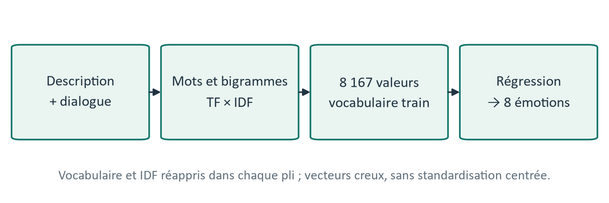

- **TF** : plus un mot est fréquent **dans ce texte**, plus il pèse (en logarithme, pour qu'un mot répété dix
  fois ne pèse pas dix fois plus) ;
- **IDF** : plus un mot est **rare dans l'ensemble des textes**, plus il pèse. « the » ou « man » apparaissent
  partout et pèsent peu ; « screams » ou « funeral » sont rares et pèsent beaucoup.

Réglages : mots seuls et **paires de mots** (bigrammes, par exemple « dark room »), mots vides anglais
retirés (*the*, *a*, *is*…), mots présents dans au moins deux textes. Le vocabulaire obtenu sur train
compte **8 167 mots et paires** : chaque texte devient un vecteur de 8 167 valeurs, presque toutes nulles.
Une **régression logistique** apprend ensuite un poids par mot et par émotion, exactement comme pour les
descripteurs audio (partie 5.2). Le vocabulaire et les poids IDF sont réappris dans chaque pli de la
validation croisée, puisqu'ils dépendent des textes d'apprentissage. Le réglage C est choisi parmi 0,1 ;
0,3 ; 1 ; 3 et 10, avec ou sans pondération des classes ; un SVM linéaire est aussi comparé.

Tableau : N1 texte (F1 cv : moyenne des cinq plis)
| Entrée | Régression logistique | SVM linéaire |
|---|---:|---:|
| description | 0,286 | 0,282 |
| dialogue | 0,158 | 0,154 |
| description + dialogue | **0,295** | 0,287 |

Réglage retenu : description et dialogue réunis en un seul texte, régression logistique, C = 1, classes
pondérées (**F1 cv 0,295, dev 0,295**). La régression logistique est gardée même quand le SVM fait jeu égal,
parce qu'elle donne des probabilités, nécessaires aux combinaisons et à la fusion.

Comme pour l'audio, on peut lire ce que le modèle a appris : les mots qui ont le plus fort poids positif pour
chaque émotion.

Tableau : Mots et paires de mots les plus associés à chaque émotion (N1 texte, modèle appris sur train)
| Émotion | Mots les plus associés |
|---|---|
| amusement | dancing, playing, smiling, lively, lively scene, cows, ice |
| anger | gun, man, plaid, plaid shirt, men, uniform, hair beard |
| awe | man suit, suit, tie, bus, flashlight, robes, desert |
| contentment | lying bed, sitting, trees, child, lying, bed, woman sitting |
| disgust | subway, subway car, woman blonde, shirt, car, table, standing room |
| excitement | smiling, smiling looking, sunglasses, engaged conversation, jacket, boat, hats |
| fear | dark, person, dark room, lying, large, ground, light |
| sadness | dark, background dark, dimly, dimly lit, lit room, kitchen, lit |

Le modèle s'appuie surtout sur la **description visuelle** : l'obscurité (*dark*, *dimly lit*) annonce la
peur et la tristesse, les sourires et la danse l'amusement et l'excitation, les armes la colère. Certains
mots reflètent des habitudes du corpus plus que l'émotion (*plaid shirt*, *subway*), signe que le modèle
apprend aussi des particularités de quelques films : c'est pour cette raison que la validation croisée est
groupée par film.

### 6.3 N2 : encodeurs de phrases pré-entraînés et gelés

Un encodeur de phrases est un réseau Transformer pré-entraîné à rapprocher les phrases de même sens. Le texte
est découpé en **jetons** (des morceaux de mots), chaque couche transforme les vecteurs des jetons, et la
**moyenne des vecteurs de la dernière couche** donne un vecteur pour tout le texte. L'encodeur est gelé ; seule
une régression logistique est apprise (C entre 0,0003 et 0,03, avec ou sans pondération des classes).

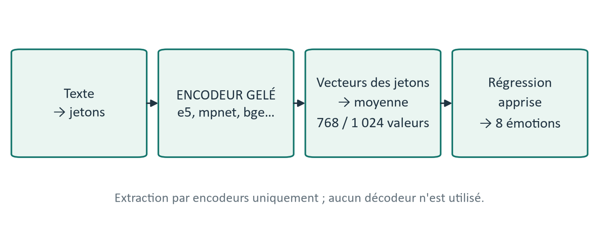

Tableau : Les cinq encodeurs de phrases du N2 texte
| Nom | Modèle | Couches | Taille du vecteur | Particularité |
|---|---|---:|---:|---|
| mpnet | sentence-transformers/all-mpnet-base-v2 | 12 | 768 | encodeur de phrases généraliste |
| e5 | intfloat/e5-large-v2 | 24 | 1 024 | encodeur généraliste ; le texte est préfixé par « query: », comme le demande le modèle |
| bge | BAAI/bge-large-en-v1.5 | 24 | 1 024 | encodeur généraliste |
| goemotions | SamLowe/roberta-base-go_emotions | 12 | 768 | déjà entraîné à reconnaître 28 émotions (commentaires Reddit) |
| ekman | j-hartmann/emotion-english-roberta-large | 24 | 1 024 | déjà entraîné sur les 6 émotions d'Ekman et le neutre |

Quatre façons de donner le texte sont comparées : la description seule, le dialogue seul, les deux encodés
**séparément** puis mis bout à bout (le vecteur du dialogue vaut 0 s'il n'y en a pas, avec un indicateur
« dialogue présent »), ou les deux **concaténés** en un seul texte.

Tableau : N2 texte (F1 cv ; en gras, l'entrée retenue pour chaque modèle)
| Modèle | description | dialogue | description + dialogue | concaténation |
|---|---:|---:|---:|---:|
| e5 | 0,323 | 0,175 | 0,324 | **0,330** |
| ekman | 0,319 | 0,172 | **0,321** | 0,313 |
| mpnet | 0,314 | 0,169 | **0,320** | 0,308 |
| bge | 0,313 | 0,176 | **0,315** | 0,313 |
| goemotions | **0,299** | 0,169 | 0,295 | 0,288 |

- Les encodeurs pré-entraînés dépassent le TF-IDF (jusqu'à +3,5 points pour e5) : ils connaissent les
  synonymes et le contexte, alors que le TF-IDF doit tout apprendre de 2 207 extraits.
- Le **dialogue seul est faible** (F1 ≈ 0,17) ; ajouté à la description, il aide un peu.
- La moyenne des six modèles N1 et N2 donne 0,352 en CV et 0,366 sur dev.

### 6.4 N3 : fine-tuning

Au N3 du texte, le modèle n'est plus gelé : il est **affiné** sur nos données. Différence essentielle avec le
N2 : en N2, seuls les poids de la régression logistique sont appris (de 8 000 à 16 000 environ) ; ici,
**toutes les couches** (110 à 355 millions de paramètres) sont ajustées pour notre tâche. Le déroulé :

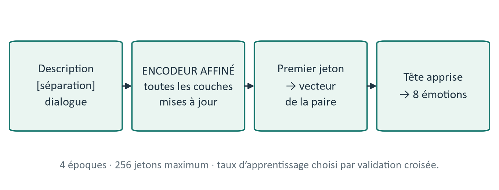

1. description et dialogue sont donnés comme une **paire de textes** (« [début] description [séparation]
   dialogue »), coupée à 256 jetons ;
2. une **nouvelle tête de classification** à 8 sorties est posée sur le vecteur du premier jeton, qui résume
   la paire ;
3. l'apprentissage minimise l'entropie croisée **pondérée par classe**, avec AdamW (régularisation 0,01),
   4 époques, des lots de 16 textes, en demi-précision sur la carte graphique ; le taux d'apprentissage monte
   pendant les premiers 10 % des étapes, puis décroît linéairement jusqu'à zéro ;
4. le **taux d'apprentissage** est choisi parmi 1e-5, 2e-5 et 3e-5 : pour chaque taux, une validation croisée
   complète (5 modèles affinés) ; le meilleur taux sert au modèle final, affiné sur tout train.

Les cinq modèles du N2 et RoBERTa-large sont affinés : 6 modèles × 3 taux × 5 plis, plus les modèles finaux,
soit environ 3 h 30 de calcul.

Tableau : N3 texte (F1 cv par taux d'apprentissage ; en gras, le taux retenu)
| Modèle | lr 1e-5 | lr 2e-5 | lr 3e-5 | Gelé (N2) | F1 dev |
|---|---:|---:|---:|---:|---:|
| ekman (RoBERTa-large, émotions) | 0,320 | 0,335 | **0,341** | 0,322 | 0,352 |
| e5-large | 0,315 | 0,318 | **0,335** | 0,330 | 0,339 |
| RoBERTa-large | **0,331** | 0,310 | 0,270 | — | 0,368 |
| bge-large | 0,318 | **0,323** | 0,313 | 0,315 | 0,370 |
| goemotions (RoBERTa-base) | 0,260 | 0,292 | **0,297** | 0,299 | 0,323 |
| mpnet (base) | 0,278 | **0,290** | 0,288 | 0,320 | 0,292 |

- Le fine-tuning aide les **grands** modèles (ekman +1,9 point, bge +0,8, e5 +0,5 en CV) mais pas les
  **petits** : mpnet perd 3 points, signe de surapprentissage avec 2 207 exemples.
- Le taux d'apprentissage compte beaucoup : RoBERTa-large passe de 0,331 à 0,270 entre 1e-5 et 3e-5 ; un
  taux fixe aurait faussé la comparaison.
- Un pré-entraînement sur des émotions semble aider : ekman dépasse RoBERTa-large d'un point en CV.

### 6.5 Système texte final et matrices de confusion

La combinaison (partie 4.7) retient **6 modèles** : ekman, e5, RoBERTa et bge affinés, plus e5 et ekman gelés.
**F1 cv 0,362, F1 dev 0,387**, exactitude 38,9 %. Le gain sur le meilleur modèle seul est
significatif sur dev (intervalle [+0,003 ; +0,066]) : la combinaison progresse surtout parce que les modèles
affinés se trompent sur des extraits différents. En n'affinant qu'ekman, elle restait à 0,351 en CV.

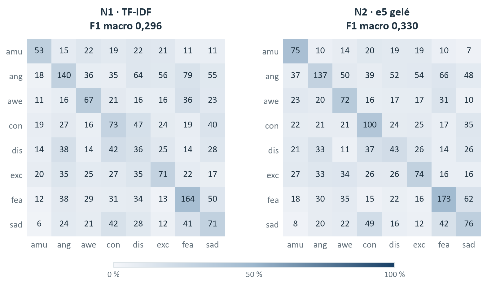

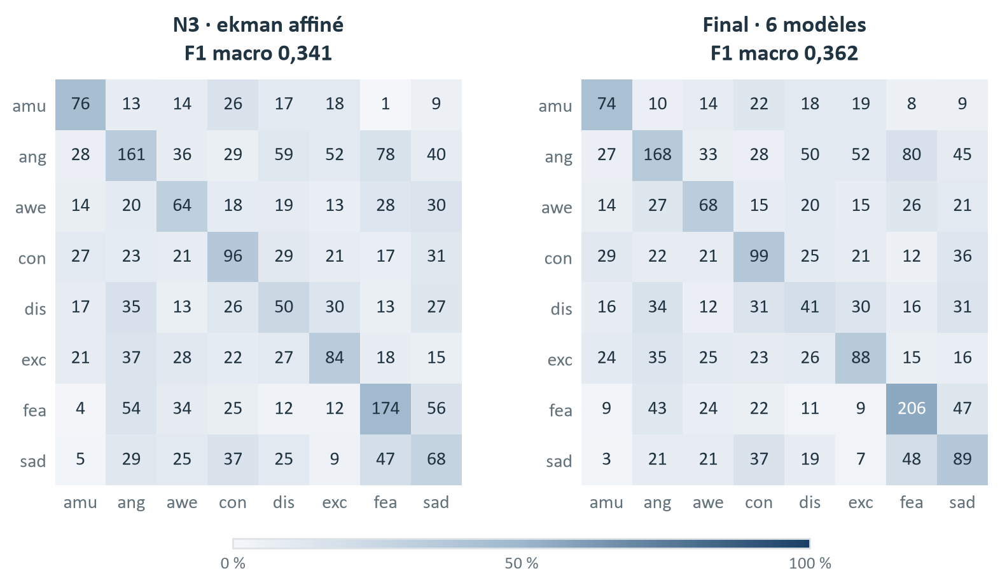

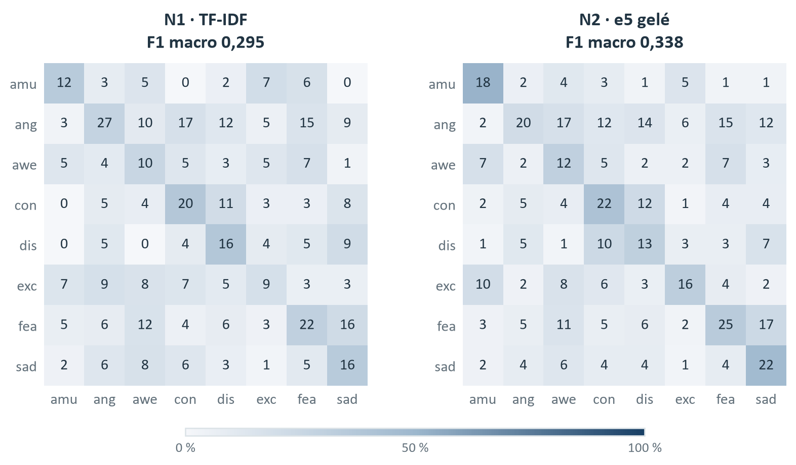

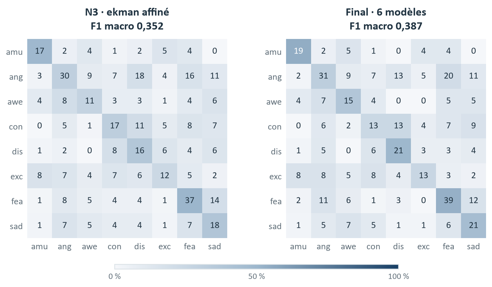

Le texte reconnaît bien l'**amusement** et la **peur**, et c'est la meilleure modalité pour le **dégoût**
(F1 dev 0,43, contre 0,27 pour la vidéo) : le dégoût se dit ou se décrit plus qu'il ne se voit. Les
confusions les plus fréquentes concernent les trois émotions positives proches, *awe*, *excitement* et
*contentment* : la description dit ce qui se passe, rarement ce que l'on ressent.

> **À retenir**
> La description apporte l'essentiel du signal ; le dialogue seul reste faible. L'affinage aide surtout les grands modèles. Le texte complète particulièrement bien la vidéo pour le dégoût.


## 7. Modèle vidéo (point 4)

> **En bref**
> Seize images résument chaque extrait. Les descripteurs de couleur sont comparés aux encodeurs d'images et aux expressions faciales. Une attention peut pondérer les images. Six modèles combinés atteignent 0,450 en F1 cv et 0,461 sur dev.

### 7.1 Préparation des images

**Écrans de fin.** Le nettoyage décrit au chapitre 2 fixe la fin utile des 33 extraits concernés, sans utiliser leurs étiquettes.

**Seize images par extrait** (`01_extraire_images.py`) : la partie utile est découpée en 16 intervalles
égaux, et l'on prend l'image au milieu de chacun. On évite ainsi la toute première et la toute dernière
image, souvent un fondu ou un changement de plan. Les images sont gardées en couleur, sans recadrage, avec
640 pixels de large au plus (assez pour détecter les visages).

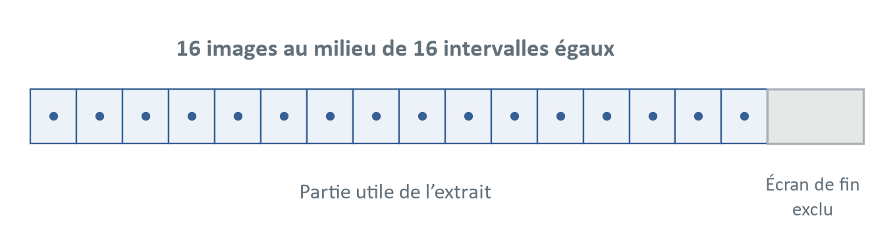

### 7.2 N1 : couleurs, luminosité et mouvement

Chaque image est réduite à 160 × 90 pixels et convertie en **HSV** : teinte (la couleur), saturation
(couleur vive ou grisée) et luminosité. Sur chaque image, on calcule :

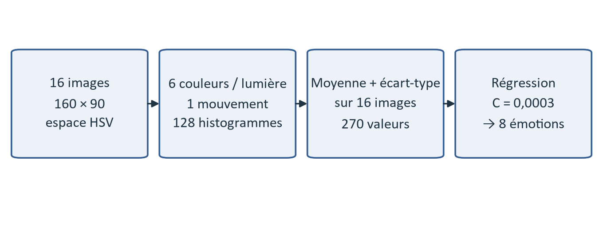

- la moyenne et l'écart-type de la teinte, de la saturation et de la luminosité (6 valeurs) ;
- le **mouvement** : la différence moyenne de luminosité avec l'image précédente (1 valeur) ;
- un **histogramme de couleurs** : la part des pixels dans chacune des 8 teintes × 4 saturations × 4
  luminosités (128 valeurs).

Ces 135 valeurs sont résumées sur les 16 images par leur moyenne et leur écart-type : **270 descripteurs**.
Régression logistique, C choisi parmi 9 valeurs de 0,0001 à 1 : retenu **C = 0,0003** (régularisation très
forte), classes pondérées. **F1 cv 0,192, F1 dev 0,200.**

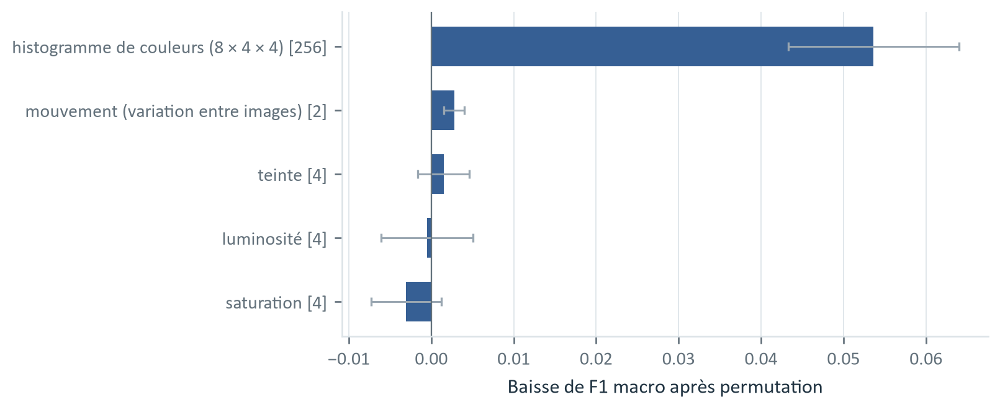

Mesurée comme pour l'audio (permutation par famille en validation croisée), l'importance montre que
l'**histogramme de couleurs** porte presque toute l'information : le brouiller fait perdre 0,054 de F1, soit
près de 30 % du score. La teinte, la saturation et la luminosité moyennes n'apportent rien de plus, car
l'histogramme les contient déjà ; le mouvement apporte un peu. Les couleurs décrivent l'**ambiance** d'une
scène (sombre, chaude, froide), mais peu son contenu émotionnel : d'où un score modeste. Ce recalcul
redonne exactement le score du module (0,185 en moyenne par pli), ce qui vérifie que le N1 se reproduit.

### 7.3 N2 : encodeurs d'images gelés et visages

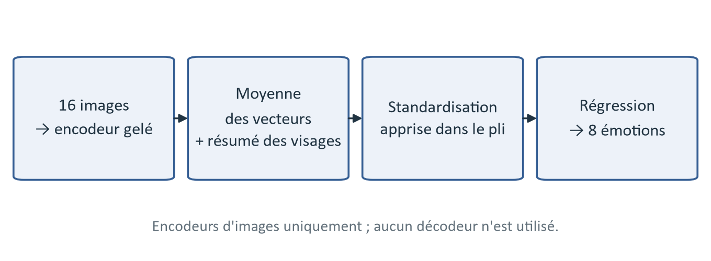

#### Les encodeurs d'images

Tableau : Les sept encodeurs vidéo comparés en N2
| Encodeur | Modèle | Pré-entraînement | Vecteur |
|---|---|---|---:|
| CLIP-B | openai/clip-vit-base-patch16 | paires image-texte (OpenAI, 2021) | 512 par image |
| CLIP-L | openai/clip-vit-large-patch14 | idem, modèle plus grand | 768 par image |
| CLIP-H | laion/CLIP-ViT-H-14-laion2B-s32B-b79K | 2 milliards de paires image-texte (LAION) | 1 024 par image |
| SigLIP 2 | google/siglip2-so400m-patch14-384 | paires image-texte (Google, 2025) | 1 152 par image |
| PE | timm/PE-Core-L-14-336 (*Perception Encoder*) | paires image-texte (Meta, 2025) | 1 024 par image |
| DINOv2 | facebook/dinov2-base | images seules, auto-supervisé | 768 par image |
| VideoMAE | MCG-NJU/videomae-base-finetuned-kinetics | les 16 images ensemble (actions, Kinetics-400) | 768 par extrait |

Les modèles **image-texte** (CLIP, SigLIP 2, PE) ont appris à rapprocher une image de sa légende : leurs
vecteurs résument des **concepts** (une pièce sombre, une arme, un enfant qui rit, un visage crispé), ce qui
les rend très adaptés à notre tâche. Comme pour l'audio, on n'utilise que leur **encodeur d'images** (pas
leur partie texte) : chaque image donne un vecteur, normalisé à une longueur de 1. DINOv2 ne connaît que les
images ; VideoMAE regarde les 16 images ensemble pour capter le mouvement et donne un seul vecteur par
extrait.

#### Les visages

Sur chacune des 16 images, **YuNet** (détecteur de visages d'OpenCV) cherche les visages (score de confiance
d'au moins 0,6) et l'on garde les deux plus grands. Chaque visage est découpé avec une marge de 20 % puis
décrit par deux modèles d'**expression faciale** gelés :

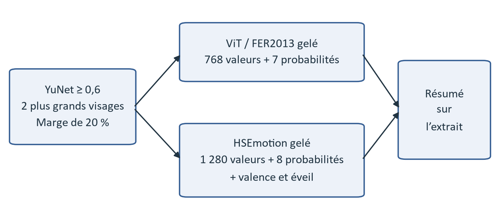

- un **ViT entraîné sur FER2013** : un vecteur de 768 valeurs et 7 probabilités d'expression (colère,
  dégoût, peur, joie, tristesse, surprise, neutre) ;
- **HSEmotion** (EfficientNet-B0 entraîné sur AffectNet, des photos réelles) : un vecteur de 1 280 valeurs,
  8 probabilités d'expression, plus la **valence** (agréable ou désagréable) et l'**éveil** (calme ou excité).

Pour le N2, ces sorties sont **résumées sur l'extrait** : part des images avec un visage, nombre moyen de
visages, taille moyenne du plus grand visage, présence d'au moins un visage, puis, pour chaque modèle, la
moyenne de ses vecteurs et de ses probabilités sur tous les visages trouvés, le maximum de chaque
probabilité, et la valence et l'éveil moyens. Les expressions faciales ne sont pas nos huit émotions : le
classifieur apprend lui-même leur lien avec elles.

Tableau : Part des images contenant au moins un visage, par émotion
| amusement | anger | awe | contentment | disgust | excitement | fear | sadness |
|---:|---:|---:|---:|---:|---:|---:|---:|
| 77 % | 87 % | 69 % | 81 % | 90 % | 86 % | **52 %** | 80 % |

Au moins un visage est détecté dans 2 849 extraits sur 3 088. La **peur** se distingue : seulement 52 % de
ses images contiennent un visage (scènes sombres, menace hors champ, plans larges), contre 90 % pour le
dégoût. L'absence de visage est donc elle-même une information utile.

#### La recherche des réglages

Comme pour l'audio, on avance étape par étape pour chaque encodeur, en gardant à chaque étape le meilleur F1
cv : nombre d'images (4, 8 ou 16) et résumé (moyenne, ou moyenne + écart-type), puis visages (aucun, ViT,
HSEmotion ou les deux), puis classifieur (régression logistique avec C entre 0,00001 et 0,1, analyse
discriminante, ou SVM réglé par 25 essais Optuna puis calibré) ; enfin, les visages seuls. **123
configurations** au total ; la régression logistique est retenue pour toutes les sorties.

Tableau : Meilleure configuration de chaque encodeur vidéo (F1 cv sur les prédictions hors pli)
| Sortie retenue | Images | Visages | F1 cv | F1 dev |
|---|---|---|---:|---:|
| PE | 16 | ViT + HSEmotion | **0,430** | **0,441** |
| SigLIP 2 | 16 | ViT | 0,408 | 0,415 |
| CLIP-B | 8 | ViT | 0,406 | 0,417 |
| CLIP-H | 16 | HSEmotion | 0,405 | 0,417 |
| CLIP-L | 16 | ViT | 0,401 | 0,423 |
| DINOv2 | 4 | HSEmotion | 0,373 | 0,399 |
| VideoMAE | 16 (un vecteur par extrait) | ViT + HSEmotion | 0,358 | 0,404 |
| Visages seuls | — | ViT | 0,304 | 0,321 |

- Les modèles **image-texte récents** (PE, SigLIP 2) sont les meilleurs ; DINOv2 (images seules) et
  VideoMAE (mouvement) sont derrière : nos émotions se lisent plus dans le **contenu** des images que dans le
  mouvement.
- La **moyenne simple** des 16 vecteurs suffit ; l'écart-type n'aide pas.
- Les **visages seuls** font 0,304, mais ajoutés aux images ils aident **toutes** les configurations
  retenues : ils apportent l'expression, que l'encodeur général capte moins bien.

### 7.4 N3 : tête d'attention sur les 16 images

C'est la **même tête d'attention** que pour l'audio (partie 5.4, figure de la tête d'attention), les 16
tranches de son étant remplacées par les 16 images : une couche cachée commune, un neurone de score par
image, une moyenne pondérée, une couche de sortie. L'entrée de chaque image est le vecteur de l'encodeur,
auquel on ajoute les caractéristiques du **plus grand visage de cette image** : présence, taille, vecteur et
probabilités du modèle d'expression choisi (0 s'il n'y a pas de visage). Le choix des visages (aucun, ViT,
HSEmotion, les deux) fait partie des réglages d'Optuna, avec la taille de la couche cachée, le dropout, le
taux d'apprentissage, la régularisation, le nombre d'époques et la part d'images retirées au hasard pendant
l'apprentissage. Réglage retenu pour PE : visages ViT, 128 neurones, dropout 0,53, taux d'apprentissage
3e-4, 17 époques, 26 % des images retirées.

Tableau : N2 contre N3 pour les encodeurs vidéo (F1 cv)
| Encodeur | N2 | N3 attention | F1 dev de N3 |
|---|---:|---:|---:|
| PE | **0,430** | 0,421 | 0,454 |
| SigLIP 2 | 0,408 | **0,419** | 0,428 |
| CLIP-L | 0,401 | 0,401 | 0,422 |
| CLIP-H | **0,405** | 0,395 | 0,444 |
| CLIP-B | **0,406** | 0,393 | 0,380 |
| DINOv2 | **0,373** | 0,369 | 0,395 |

Comme pour l'audio, l'attention n'améliore pas systématiquement le modèle seul (SigLIP 2 progresse, PE
recule), mais ses erreurs sont différentes et elle sert la combinaison.

### 7.5 Système vidéo final et matrices de confusion

La combinaison retient **6 modèles** : PE, SigLIP 2, CLIP-B et CLIP-H avec régression logistique, plus PE et
SigLIP 2 avec attention. **F1 cv 0,450, F1 dev 0,461**, exactitude 45,7 %. Le gain sur PE
seul n'est pas significatif sur dev (intervalle [−0,008 ; +0,047]).

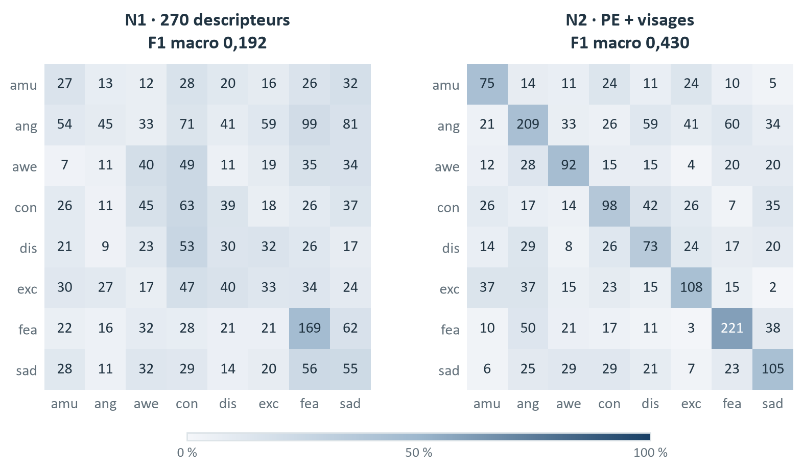

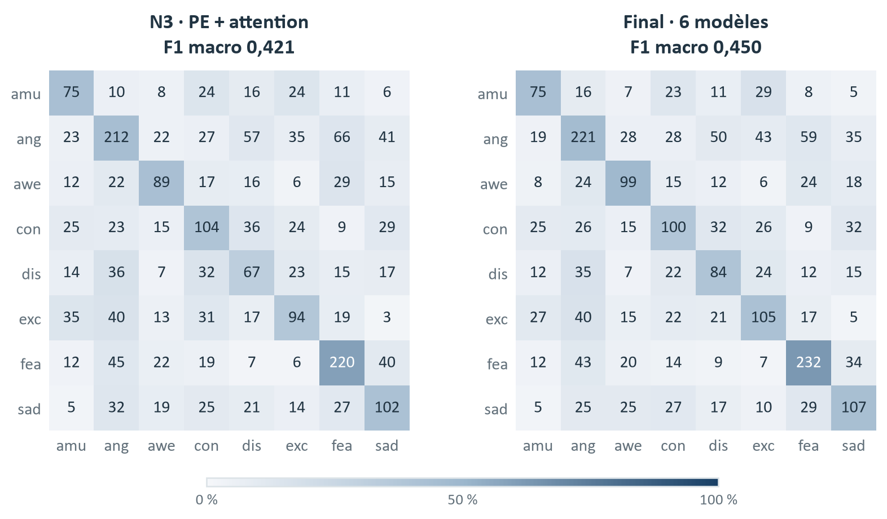

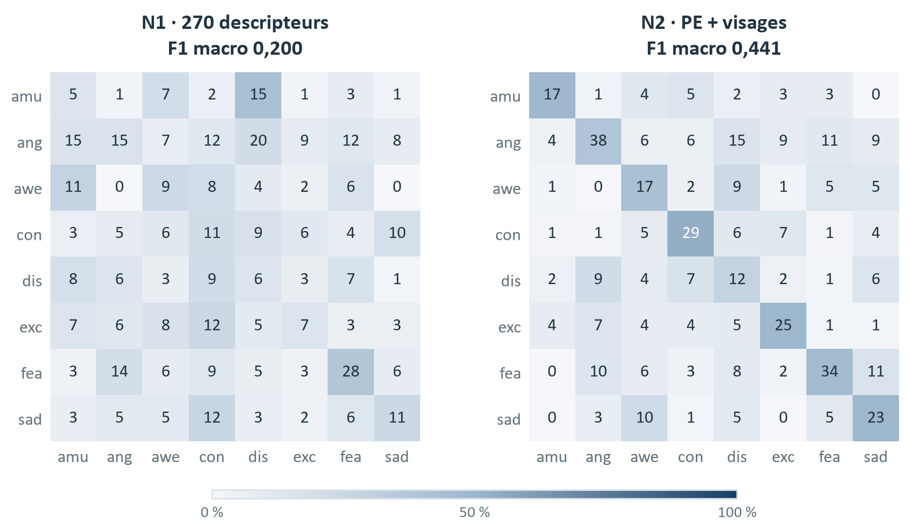

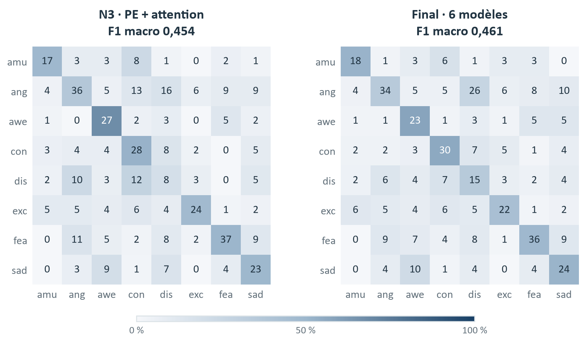

La vidéo est la meilleure modalité pour presque toutes les émotions. Elle reconnaît bien la **peur**, la
**satisfaction** et l'**amusement**, et peine sur le **dégoût**, souvent confondu avec la colère : les deux
montrent des visages crispés et des scènes tendues. Le saut entre N1 (couleurs) et N2 (encodeurs) est le plus
fort de tout le projet, de 0,19 à 0,43 : comprendre le contenu d'une image compte bien plus que ses couleurs.

> **À retenir**
> Le contenu des images compte davantage que leur couleur ou leur mouvement. Les visages complètent les encodeurs. La vidéo domine, en cohérence avec une annotation principalement visuelle.


## 8. Fusion des modalités (point 5)

> **En bref**
> Trois options sont comparées : moyenne des probabilités, concaténation des vecteurs et attention multimodale. Le choix est arrêté par F1 cv. La moyenne pondérée est retenue avec les poids vidéo 0,6, texte 0,2 et audio 0,2. L'évaluation test est présentée ici.

### 8.1 Principe et entrées

La fusion part de ce que chaque modalité a produit au point 4 : ses **probabilités** (une par émotion et par
extrait) et, pour train, ses **probabilités hors pli**. Ces dernières sont indispensables : elles permettent
d'apprendre comment combiner les modalités (poids, classifieur, réseau) sur 2 207 extraits de train, avec des
prédictions de modèles qui n'ont pas vu l'extrait, exactement comme le seront celles de dev et de test.
Sans elles, il aurait fallu apprendre la fusion sur dev, qui n'aurait plus été une mesure indépendante.

Pour les options B et C, il faut aussi des **vecteurs** : chaque modalité y est représentée par son meilleur
encodeur gelé. Les vecteurs vidéo ont été recalculés avec les scripts du module vidéo, sans modification ;
ils redonnent exactement ses scores (PE moyenné, sans visages : 0,4241 en CV, 0,4110 sur dev), ce qui
confirme que le module se reproduit sur une autre machine.

### 8.2 Les trois options

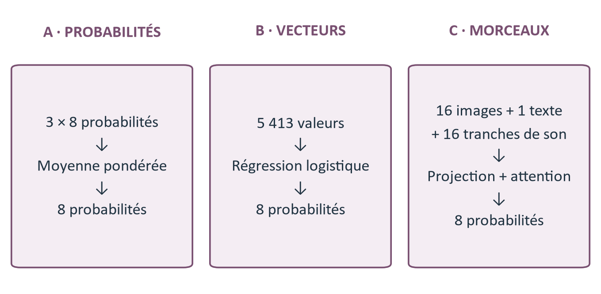

### 8.3 Option A : fusion tardive

Chaque modalité a déjà « voté » avec ses 8 probabilités ; on combine les votes, comme un jury de trois
experts. Trois variantes sont comparées.

- **Moyenne simple** : p = (p_vidéo + p_texte + p_audio) / 3.
- **Moyenne pondérée** : p = (w_v × p_vidéo + w_t × p_texte + w_a × p_audio) / (w_v + w_t + w_a). Chaque
  poids est essayé de 0 à 1 par pas de 0,1, soit 11 × 11 × 11 − 1 = 1 330 combinaisons ; chacune est évaluée
  sur les probabilités hors pli de train, et l'on garde la meilleure. Seules les proportions comptent : le
  réglage trouvé, 0,3 / 0,1 / 0,1, est le même que 3 / 1 / 1 ou que 0,6 / 0,2 / 0,2.
- **Stacking** : une régression logistique reçoit les 24 log-probabilités (3 modalités × 8) et apprend des
  règles plus fines (par exemple « croire le texte quand il dit *disgust* »). Son réglage C est choisi en
  validation croisée.

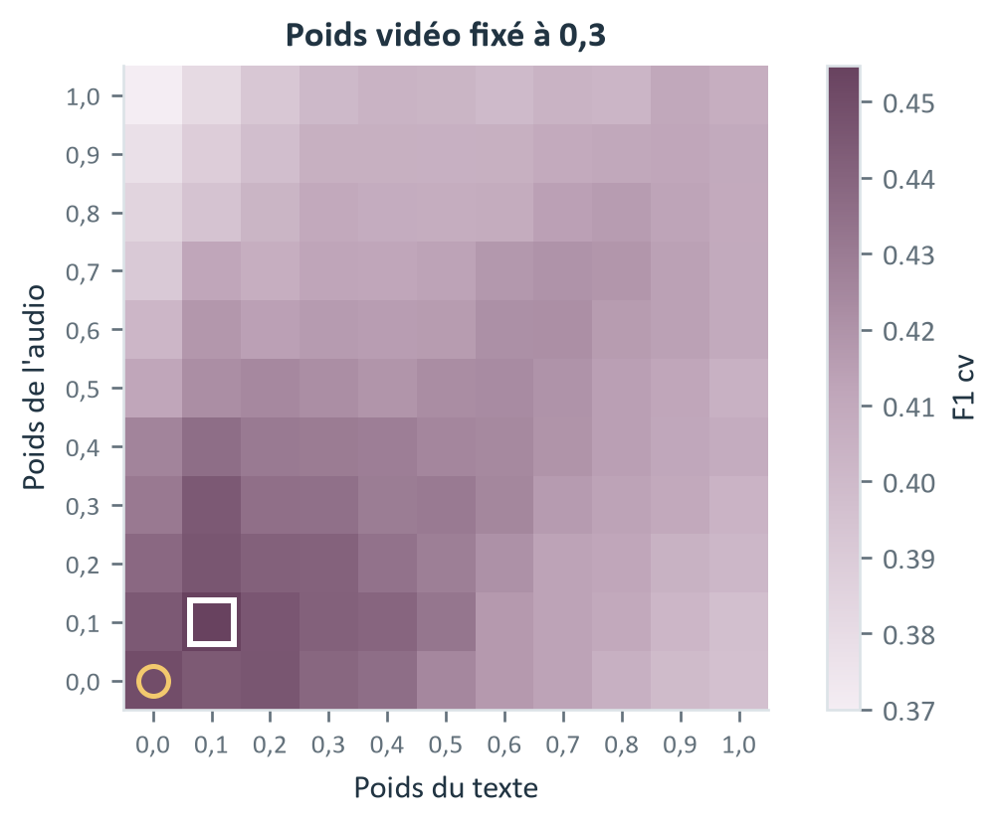

Tableau : Option A, sur les systèmes finaux du point 4
| Méthode | Poids ou réglage | F1 cv | F1 dev |
|---|---|---:|---:|
| Vidéo seule | — | 0,450 | 0,461 |
| Moyenne simple | 1 / 1 / 1 | 0,435 | 0,451 |
| **Moyenne pondérée** | **vidéo 0,6, texte 0,2, audio 0,2** | **0,455** | **0,486** |
| Stacking | C = 0,003, classes pondérées | 0,412 | 0,452 |

Tableau : Apport de chaque modalité (moyenne pondérée)
| Modalités | Poids retenus | F1 cv | F1 dev |
|---|---|---:|---:|
| Vidéo + texte | 0,7 / 0,1 | 0,451 | 0,474 |
| Vidéo + audio | 0,1 / 0 | 0,450 | 0,461 |
| Texte + audio | 0,2 / 0,1 | 0,371 | 0,390 |
| Vidéo + texte + audio | 0,3 / 0,1 / 0,1 | **0,455** | **0,486** |

- La **moyenne simple dégrade** la vidéo seule : elle donne autant de poids à l'audio (0,271) et au texte
  (0,362) qu'à la vidéo (0,450). Il faut des poids.
- Le **stacking** a trop de paramètres (24 × 8 + 8 = 200) pour 2 207 exemples ; il fait moins bien que la
  moyenne simple en validation croisée.
- **Seul avec la vidéo, l'audio n'apporte rien** (son poids choisi est 0) ; **avec le texte, il reçoit le
  même poids que lui**, et le trio dépasse la paire vidéo + texte.

### 8.4 Option B : fusion précoce

On revient un cran en arrière : au lieu de combiner les réponses, on combine les **vecteurs**, avant toute
décision. Pour chaque extrait, on met bout à bout :

- **vidéo** : PE moyenné sur les 16 images (1 024 valeurs) et le résumé des visages ViT et HSEmotion (2 084) ;
- **texte** : e5-large sur la description et le dialogue (1 024) et l'indicateur « dialogue présent » (1) ;
- **audio** : Whisper, couche 16, moyenne dans le temps (1 280).

Ces **5 413 valeurs** sont standardisées, puis une seule régression logistique apprend (C et pondération des
classes choisis en validation croisée), soit 43 312 paramètres. Deux variantes : **brute** (chaque colonne
compte autant, donc la vidéo, avec 3 108 colonnes, pèse le plus) et **équilibrée** (chaque modalité est
multipliée par racine(dimension moyenne / sa dimension), pour que les trois aient le même poids total).

Tableau : Option B
| Variante | Modalités | F1 cv | F1 dev |
|---|---|---:|---:|
| Brute | vidéo seule (référence) | 0,431 | 0,441 |
| Brute | vidéo + texte + audio | 0,428 | 0,438 |
| Équilibrée | vidéo + texte + audio | 0,415 | 0,438 |
| Brute | vidéo + texte | 0,428 | 0,469 |
| Brute | vidéo + audio | 0,423 | 0,432 |

En théorie, cette fusion peut apprendre des combinaisons (une image sombre avec une voix calme n'est pas une
image sombre avec des cris). En pratique, **elle ne bat pas la vidéo seule** : avec 2 207 exemples, les
colonnes du texte et de l'audio ajoutent surtout du bruit, et un seul réglage C pour toutes les colonnes
empêche de donner moins de poids à une modalité sans en donner moins aux autres. Donner le même poids aux
trois aggrave le problème.

### 8.5 Option C : un petit modèle multimodal à attention

L'option C reprend le principe de la tête d'attention du N3 (partie 5.4), mais avec **trois modalités à la
fois**. Les trois encodeurs restent gelés ; seul un petit réseau est appris.


#### Étape 1 — Les trois encodeurs gelés et ce qu'on prend de chacun

Tableau : Les entrées de l'option C (tous des encodeurs gelés, aucun décodeur)
| Modalité | Modèle | Ce qu'on lui donne | Ce qu'on récupère par morceau |
|---|---|---|---|
| Vidéo | PE, *Perception Encoder Core L/14-336* (Meta, 2025) : encodeur d'images entraîné sur des paires image-texte | chacune des 16 images | 1 024 valeurs (son vecteur final) |
| Visage (avec la vidéo) | YuNet (détection) + ViT entraîné sur FER2013 (expressions) | le plus grand visage de chaque image | 777 valeurs : présence, taille, vecteur de 768, 7 probabilités d'expression (0 si aucun visage) |
| Texte | e5-large-v2 : encodeur de phrases à 24 couches | la description suivie du dialogue | 1 024 valeurs (moyenne de la dernière couche) + 1 « dialogue présent » |
| Audio | encodeur de Whisper large-v3 (32 couches) | le son, coupé en 16 tranches de même durée | 1 280 valeurs par tranche (moyenne de toutes les couches sur la tranche) |

Chaque extrait devient ainsi une suite de **33 morceaux** : 16 images (1 801 valeurs chacune), 1 texte
(1 025) et 16 tranches de son (1 280). Ce sont les mêmes encodeurs que ceux du point 4 : rien de nouveau
n'est entraîné dans ces modèles. Chaque modalité est standardisée avec la moyenne et l'écart-type de ses
extraits d'apprentissage.


#### Étape 2 — Mettre les trois modalités à la même taille

Une image, un texte et une tranche de son n'ont ni la même taille ni le même sens : on ne peut pas les
comparer directement. Chaque modalité passe donc par **sa propre couche de projection** (linéaire, puis GELU
et dropout), qui la ramène à **256 valeurs** : une projection pour les images, une pour le texte, une pour le
son. La même projection sert pour les 16 images ; une autre sert pour les 16 tranches.

On ajoute ensuite à chaque morceau un **« badge » de modalité** : un vecteur de 256 valeurs, appris, propre à
chaque modalité. Il indique au réseau si le morceau vient d'une image, du texte ou du son.

#### Étape 3 — Le point de rencontre : l'attention

Les 33 vecteurs, désormais de même taille, sont mis dans une seule liste. Un neurone donne une **note
d'importance** à chacun ; un *softmax* transforme les 33 notes en 33 poids qui font 100 % ; la **moyenne
pondérée** des 33 vecteurs donne **un seul vecteur de 256 valeurs**, qui résume l'extrait entier, toutes
modalités confondues. C'est là que les trois branches se rejoignent.

Une option supplémentaire a été testée avant cette étape : une couche de *self-attention* (Transformer, 4
têtes), où chaque morceau peut « regarder » les autres (une image regarde une tranche de son, par exemple).
Optuna ne l'a **pas retenue** : elle n'aidait pas avec si peu de données.

#### Étape 4 — La décision

Le vecteur de 256 valeurs passe par un dropout et une couche de sortie de 8 neurones ; un *softmax* donne
les 8 probabilités. En formules, pour un morceau x de la modalité m :

```
projection :   z    = dropout(GELU(W_m · x + b_m)) + badge_m          (256 valeurs)
note :         s    = w · z + b                                       (un nombre par morceau)
poids :        a    = softmax(s) sur les 33 morceaux                  (33 poids, total 1)
résumé :       h    = somme des a × z                                 (256 valeurs)
sortie :       p    = softmax(W_out · dropout(h) + b_out)             (8 probabilités)
```

#### Apprentissage

- Entropie croisée pondérée par classe, optimiseur AdamW, lots de 64 extraits, nombre d'époques fixé.
- Pour que le réseau n'écoute pas que la vidéo, deux « coups de frein » à chaque lot : une partie des 33
  morceaux est cachée au hasard, et **chaque modalité entière peut être cachée indépendamment**, pour chaque extrait (toutes ses images, tout son texte ou tout son son). Au moins un morceau est ensuite conservé. Le réseau doit alors se débrouiller sans elle.
- Réglages choisis par **30 essais Optuna**, chacun évalué en validation croisée par film : taille (128 ou
  256), avec ou sans couche de self-attention, dropout (0,1 à 0,6), taux d'apprentissage (1e-4 à 3e-3),
  régularisation (1e-4 à 0,1), époques (5 à 40), part de morceaux cachés (0 à 50 %), probabilité de cacher une
  modalité (0 à 40 %).
- **Réglage retenu** : 256, sans self-attention, dropout 0,31, taux d'apprentissage 1,5e-4, régularisation
  0,0025, 16 époques, 19 % des morceaux cachés, probabilité de masquage de 19 % par modalité et par extrait.
- Le réglage retenu est réappris avec 3 graines (probabilités moyennées), en validation croisée pour obtenir
  les probabilités hors pli, puis sur tout train pour prédire dev et test.

Tableau : Taille de l'option C (paramètres appris)
| Partie | Calcul | Paramètres |
|---|---|---:|
| Projection des images | 1 801 × 256 + 256 | 461 312 |
| Projection du son | 1 280 × 256 + 256 | 327 936 |
| Projection du texte | 1 025 × 256 + 256 | 262 656 |
| Badges de modalité | 3 × 256 | 768 |
| Neurone de score | 256 + 1 | 257 |
| Couche de sortie | 256 × 8 + 8 | 2 056 |
| **Total** | | **1 054 985 (≈ 1,05 million)** |

#### Résultats

**F1 cv 0,439, F1 dev 0,450**. Le modèle fait mieux que la vidéo seule avec les mêmes entrées (0,431) et que
la fusion précoce (0,428). Mais sur dev, il donne en moyenne **95 % de son attention aux images**, 3 % au
texte et 2 % au son : malgré les modalités cachées pendant l'apprentissage, il a appris que la vidéo suffit
presque. C'est cohérent avec l'annotation du corpus, faite à partir des images.

Un grand modèle multimodal pré-entraîné (du type Qwen2.5-Omni, qui traite à la fois images, son et texte)
n'a pas été essayé : il ne tient pas sur une carte graphique de 8 Go, et l'affiner avec 2 207 exemples
poserait le même problème de données.

### 8.6 Comparaison et choix du système final

B et C n'utilisent qu'un encodeur par modalité, alors que A profite des systèmes finaux du point 4 (texte
affiné, combinaisons de 4 à 6 modèles). Pour comparer à armes égales, A a aussi été appliquée aux mêmes
entrées que B et C.

Tableau : Comparaison des trois options
| Option | Système | Paramètres appris | F1 cv | F1 dev |
|---|---|---:|---:|---:|
| A | moyenne pondérée, systèmes finaux du point 4 | 3 poids | **0,455** | **0,486** |
| A | moyenne pondérée, mêmes entrées que B et C | 3 poids | 0,448 | 0,454 |
| C | attention multimodale | ≈ 1 050 000 | 0,439 | 0,450 |
| B | concaténation, brute | 43 312 | 0,428 | 0,438 |

**Même à entrées égales, la fusion tardive reste devant.** Plus une méthode apprend de paramètres, plus elle
a besoin de données ; avec 2 207 extraits, apprendre trois poids est plus sûr qu'en apprendre un million.
**Système retenu : option A, moyenne pondérée (vidéo 0,6, texte 0,2, audio 0,2)**, parce qu'elle a le
meilleur F1 cv.

### 8.7 Résultat final sur test

Tableau : Scores finaux (test calculé une seule fois)
| Système | F1 cv | F1 dev | F1 test |
|---|---:|---:|---:|
| Audio seul | 0,271 | 0,270 | 0,297 |
| Texte seul | 0,362 | 0,387 | 0,365 |
| Vidéo seule | 0,450 | 0,461 | 0,413 |
| **Fusion (moyenne pondérée)** | **0,455** | **0,486** | **0,419** |

Tableau : Système retenu, sur dev et sur test
| | F1 macro | Exactitude | Gain sur la vidéo seule (IC 95 % par films) |
|---|---:|---:|---|
| dev | 0,486 | 48,2 % | +0,025 [+0,001 ; +0,053] : significatif |
| test | 0,419 | 44,4 % | +0,006 [−0,017 ; +0,030] : non significatif |

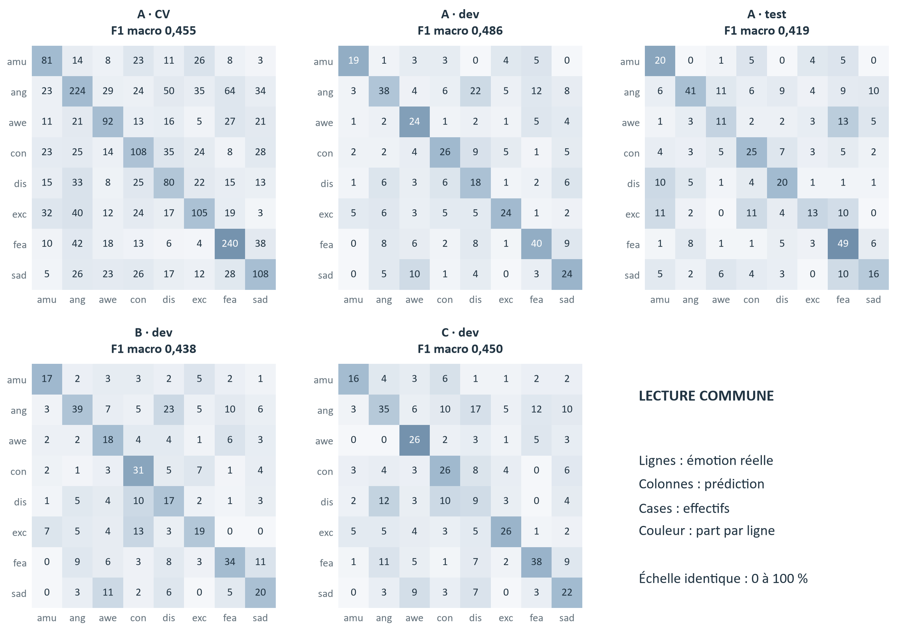

- sur test, les trois émotions positives se mélangent : l'excitation est prise pour de l'amusement ou de la
  satisfaction (11 extraits chacun), et l'émerveillement est souvent pris pour de la peur (13). C'est ce qui
  explique les rappels faibles d'*awe* (28 %) et d'*excitement* (25 %) sur test.

### 8.8 Cohérence des mesures

- **CV et dev sont proches** : audio 0,271 / 0,270 ; vidéo 0,450 / 0,461. Dev contrôle la généralisation des réglages choisis sur train.
- **Test est plus difficile que dev pour la vidéo et le texte, mais pas pour l'audio** (tableau final). Avec 50 films par ensemble, quelques films peuvent déplacer les scores de plusieurs points ; les intervalles par films quantifient cette incertitude.
- **La fusion reste la meilleure sur test**, mais son avance sur la vidéo n'y est plus significative.

> **À retenir**
> L'option A atteint 0,455 en CV, 0,486 sur dev et 0,419 sur test. Le gain sur la vidéo est significatif sur dev, mais pas sur test. L'option C apprend environ 1,05 million de paramètres et attribue 95 % de son attention aux images.


## 9. Analyse des erreurs

> **En bref**
> Les modalités ne font pas les mêmes erreurs. La vidéo reconnaît le mieux la plupart des émotions, le texte aide pour le dégoût et l'audio pour la tristesse. Les émotions positives proches restent difficiles à distinguer. L'analyse s'appuie sur dev et les prédictions hors pli.


### 9.1 Par émotion

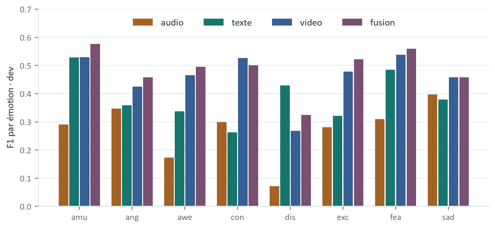

Tableau : F1 par émotion (dev)
| Émotion | Audio | Texte | Vidéo | Fusion |
|---|---:|---:|---:|---:|
| amusement | 0,29 | 0,53 | 0,53 | **0,58** |
| anger | 0,35 | 0,36 | 0,42 | **0,46** |
| awe | 0,17 | 0,34 | 0,46 | **0,49** |
| contentment | 0,30 | 0,26 | **0,53** | 0,50 |
| disgust | 0,07 | **0,43** | 0,27 | 0,32 |
| excitement | 0,28 | 0,32 | 0,48 | **0,52** |
| fear | 0,31 | 0,48 | 0,54 | **0,56** |
| sadness | 0,40 | 0,38 | **0,46** | **0,46** |

- Aux arrondis présentés, la fusion égale ou dépasse la vidéo sur **7 émotions sur 8** (seule exception : *contentment*).
- **Le texte est la meilleure modalité pour le dégoût** (0,43 contre 0,27 pour la vidéo). La fusion, qui
  donne le même petit poids au texte pour toutes les émotions, n'en récupère qu'une partie (0,32).
- **L'audio a sa meilleure émotion avec la tristesse** (0,40), presque au niveau de la vidéo : la tristesse
  s'entend dans la voix et la musique. Il est en revanche presque aveugle au dégoût (0,07) et à
  l'émerveillement (0,17).

### 9.2 Les erreurs les plus fréquentes

D'après les matrices de confusion de la fusion :

- en validation croisée, la confusion la plus fréquente est **la colère prise pour de la peur** (64 extraits),
  puis la colère prise pour du dégoût (50) et la peur prise pour de la colère (42) : les émotions « négatives
  et fortes » se ressemblent, à l'image comme au son ;
- sur dev, la colère est souvent prise pour du dégoût (22 extraits) ;


### 9.3 Ce que chaque modalité apporte

Tableau : Synthèse des apports
| Constat | Explication |
|---|---|
| La vidéo domine | Annotation faite à partir des images ; encodeurs image-texte très performants |
| Le texte aide surtout par la description | La description décrit l'image ; le dialogue seul est faible (F1 ≈ 0,17) et absent d'un tiers des extraits |
| L'audio est faible seul, mais utile en complément | Il porte des indices différents (intensité, timbre, musique), surtout pour la tristesse |
| Les fusions qui apprennent beaucoup échouent | 2 207 extraits d'apprentissage ne suffisent pas pour des milliers de paramètres |

> **À retenir**
> La complémentarité est réelle mais inégale selon l'émotion. Une pondération identique pour toutes les classes ne récupère qu'une partie des apports du texte et du son.


## 10. Conclusion, limites et pistes

> **En bref**
> Les encodeurs pré-entraînés réalisent l'essentiel du gain. Les combinaisons exploitent la diversité de leurs erreurs. Une fusion simple reste la plus adaptée aux 2 207 exemples d'apprentissage. Les limites viennent des données, de leur annotation et des petits ensembles d'évaluation.

### Conclusion

Nous avons construit, pour chaque modalité, une chaîne allant de descripteurs classiques (N1) à des
encodeurs pré-entraînés gelés (N2) et à des modèles partiellement appris (N3), avec un protocole commun :
tous les choix par validation croisée groupée par film sur train, dev réservé à la mesure, test utilisé une
seule fois. Les encodeurs pré-entraînés font l'essentiel du travail ; l'attention et le fine-tuning apportent
surtout de la diversité, utile aux combinaisons. La fusion tardive par moyenne pondérée dépasse la vidéo
seule (0,486 contre 0,461 sur dev, gain significatif ; 0,419 sur test), alors que la fusion
précoce et le modèle multimodal à attention, plus ambitieux, ne font pas mieux avec si peu de données.

### Limites

- **Biais de l'annotation** : 80 % des étiquettes viennent d'un modèle qui ne voit que les images ; nos scores
  mesurent en partie la capacité à retrouver son jugement, ce qui avantage la vidéo et pénalise l'audio.
- **Peu de données** : 2 207 extraits d'apprentissage limitent tous les modèles qui apprennent beaucoup de
  paramètres (stacking, fusion précoce, attention, fine-tuning des petits modèles).
- **Petits ensembles d'évaluation** : 50 films en dev comme en test ; des écarts d'un ou deux points ne sont
  pas significatifs, et test s'est révélé plus difficile que dev.
- **Transcription non évaluée** par un taux d'erreur sur les mots ; cris, rires et pleurs non transcrits.
- **Réglages choisis sur les mêmes prédictions hors pli** : les F1 cv sont légèrement optimistes ; dev et test
  servent de contrôle.
- **Pas de modèle déployable** : les scripts gardent les vecteurs et les probabilités, pas les poids des
  classifieurs ; prédire une vidéo extérieure demanderait une chaîne d'inférence dédiée.

### Pistes

- Pondérer la fusion **par émotion** (plus de poids au texte pour le dégoût), avec une validation croisée pour
  éviter le surapprentissage.
- Affiner un encodeur audio de parole (WavLM ou Whisper) au lieu de le garder gelé.
- Mesurer la qualité de la transcription sur un échantillon de dev transcrit à la main.
- Tester un grand modèle multimodal pré-entraîné, gelé, avec plus de mémoire graphique.

> **À retenir**
> Le système final obtient un F1 macro de 0,419 sur test. Avant de complexifier l'architecture, il faut mieux mesurer la transcription, tester les gains par film et disposer de davantage de données.


## Annexe A. Les descripteurs du N1 audio

**eGeMAPS v02 (88 valeurs).** Les 25 descripteurs de bas niveau, mesurés sur des trames courtes :

Tableau : Descripteurs de bas niveau d'eGeMAPS
| Groupe | Descripteurs | Ce qu'ils mesurent |
|---|---|---|
| Fréquence | hauteur (F0, en demi-tons), jitter | hauteur de la voix et ses micro-variations |
| Fréquence | formants F1, F2, F3 : fréquence, largeur de bande, amplitude | résonances du conduit vocal (timbre de la voix) |
| Énergie | intensité perçue (*loudness*), shimmer, HNR | volume, micro-variations d'intensité, voix claire ou soufflée |
| Spectre | alpha ratio, indice de Hammarberg, pentes 0–500 Hz et 500–1 500 Hz | répartition de l'énergie entre graves et aigus |
| Spectre | H1-H2, H1-A3 | tension ou relâchement de la voix |
| Spectre | MFCC 1 à 4, flux spectral | forme du spectre et ses changements |

Résumés sur l'extrait : moyenne et coefficient de variation (parties voisées et non voisées séparées pour
certains) ; pour la hauteur et l'intensité, centiles 20, 50 et 80, écart entre les centiles 20 et 80,
moyenne et écart-type des pentes de montée et de descente. Mesures de rythme : pics d'intensité par
seconde, segments voisés par seconde, durée moyenne et écart-type des segments voisés et des pauses,
niveau sonore équivalent.

**librosa (133 valeurs).** Voir le tableau de la partie 5.2 : MFCC (40), dérivées (40), chroma (24),
contraste (14), centroïde, largeur de bande, rolloff et platitude (8), énergie, passages par zéro et attaques
(6), tempo (1). Les noms exacts des 221 colonnes sont produits par `rapport/figures.py`.


## Annexe B. Les 76 configurations du N2 audio

Tableau : Nombre de configurations par encodeur et par étape
| Encodeur | A1 couche | A2 résumé | B ajout | D classifieur | C seul | Total |
|---|---:|---:|---:|---:|---:|---:|
| Whisper | 8 | 1 | 3 | 4 | — | 16 |
| WavLM | 8 | 1 | 3 | 4 | — | 16 |
| wav2vec2 émotion | 8 | 1 | 3 | 4 | — | 16 |
| AST | 8 | 1 | 3 | 4 | — | 16 |
| CLAP | — | 2 | 3 | 4 | — | 9 |
| AudioSet seul | — | — | — | — | 3 | 3 |
| **Total** | 32 | 6 | 15 | 20 | 3 | **76** |

Couches testées à l'étape A1 : Whisper 0, 5, 11, 16, 21, 27, 32 ; WavLM 0, 4, 8, 12, 16, 20, 24 ; wav2vec2 et
AST 0, 2, 4, 6, 8, 10, 12 ; plus la moyenne de toutes les couches. Chaque configuration est évaluée en
validation croisée par film, avec sa propre recherche de réglages. Le détail de chaque ligne est dans
`point4_audio/resultats/scores_n2.csv`.


## Annexe C. Réglages retenus

Tableau : Réglages retenus en validation croisée pour les principaux modèles
| Modèle | Réglage retenu |
|---|---|
| N1 audio | régression logistique, C = 0,003, classes pondérées |
| N2 audio Whisper | couche 16, moyenne dans le temps, régression logistique, C = 0,001, classes pondérées |
| N3 audio Whisper | 256 neurones, dropout 0,54, lr 1,2e-4, 31 époques, 20 % des tranches retirées |
| N3 audio WavLM | 256 neurones, dropout 0,57, lr 1,1e-4, 33 époques, 46 % des tranches retirées |
| Système audio | moyenne de 4 modèles (Whisper et WavLM, N2 et N3) |
| N1 vidéo | régression logistique, C = 0,0003, classes pondérées |
| N2 vidéo PE | 16 images, moyenne, visages ViT + HSEmotion, régression logistique, C = 0,001, classes pondérées |
| N3 vidéo PE | visages ViT, 128 neurones, dropout 0,53, lr 3e-4, 17 époques, 26 % des images retirées |
| Système vidéo | moyenne de 6 modèles |
| N3 texte ekman | fine-tuning, lr 3e-5, 4 époques, lots de 16 |
| Système texte | moyenne de 6 modèles |
| Fusion A | moyenne pondérée, vidéo 0,6, texte 0,2, audio 0,2 |
| Fusion B | régression logistique, C = 0,001, classes pondérées |
| Fusion C | 256, sans self-attention, dropout 0,31, lr 1,5e-4, 16 époques, 19 % / 19 % |


## Annexe D. Organisation du dépôt et reproduction

Tableau : Contenu du dépôt
| Dossier | Scripts | Résultats versionnés |
|---|---|---|
| `point2_partition/` | `statistiques.py` | listes train / dev / test |
| `point3_transcription/` | 01 à 09 : préparation, transcription, vérification, `corpus.csv` | transcriptions, décisions, corpus |
| `point4_texte/` | 01 à 06 : TF-IDF, encodeurs gelés, fine-tuning, combinaisons | scores, probabilités, matrices |
| `point4_video/` | 00 à 07 : écrans de fin, images, encodeurs, visages, N1, N2, N3, combinaison | idem |
| `point4_audio/` | 01 à 05 : N1, encodeurs, N2, N3, combinaison | idem |
| `point5_fusion/` | 01 à 04 : fusion tardive, précoce, attention, comparaison et test | idem |
| `rapport/` | `dessiner_figures.py`, `construire_rapport.py`, `verifier_resultats.py` | figures, schémas et contrôles de ce rapport |

Le code et les résultats sont publiés sur GitLab : https://gitlab.com/Maouloud3-0/projet-multimedia-m2sid

Le corpus n'est pas versionné : par défaut, les scripts le cherchent dans l'archive du cours décompressée à
côté du dépôt (`../PROJET_SID_2026/PROJET_SID_2026/movie/`), sinon dans la variable `EMOVID_DIR` (points 2 et
4) ou `PROJET_SID_DIR` (point 3). Ordre : point 3 (ou directement son `corpus.csv`), puis les trois modules
du point 4 (la vidéo avant l'audio, qui réutilise la détection des écrans de fin), puis le point 5.

Matériel : Python 3.11 et une carte graphique de 8 Go (RTX 5070 Laptop). Durées indicatives :
transcription 2 à 3 h, fine-tuning du texte 3 h 30, encodeurs vidéo et audio environ 1 h chacun, fusion moins
de 45 min. Depuis ce dépôt, `corpus.csv` se reconstruit à l'identique, et les combinaisons finales des trois
modalités et la fusion redonnent exactement les scores de ce rapport.


## Annexe E. Glossaire

Tableau : Glossaire
| Terme | Définition |
|---|---|
| Encodeur | Réseau qui transforme une entrée (son, image, texte) en vecteurs qui la résument |
| Décodeur | Non utilisé pour les modèles d'émotion des points 4 et 5 |
| Gelé | Modèle dont les poids ne sont pas modifiés ; il ne sert qu'à produire des vecteurs |
| Couche | Étape d'un réseau ; chaque couche transforme les vecteurs de la précédente |
| Fine-tuning | Ré-entraînement de toutes les couches d'un modèle pré-entraîné sur nos données |
| Tête d'attention | Petit réseau qui note l'importance de chaque morceau et en fait une moyenne pondérée |
| Softmax | Fonction qui transforme des scores en probabilités positives de somme 1 |
| Régularisation (C) | Pénalité sur la taille des poids qui limite le surapprentissage ; petit C = forte pénalité |
| Validation croisée | Apprentissage sur 4 paquets de films, prédiction du 5e, répété 5 fois |
| Prédiction hors pli | Prédiction d'un extrait de train par un modèle qui n'a pas vu son film |
| F1 macro | Moyenne des F1 des 8 émotions, chacune comptant autant |
| Optuna | Outil qui cherche automatiquement de bons réglages en un nombre d'essais fixé |
| IC 95 % par films | Intervalle obtenu en rééchantillonnant les films 2 000 fois |
