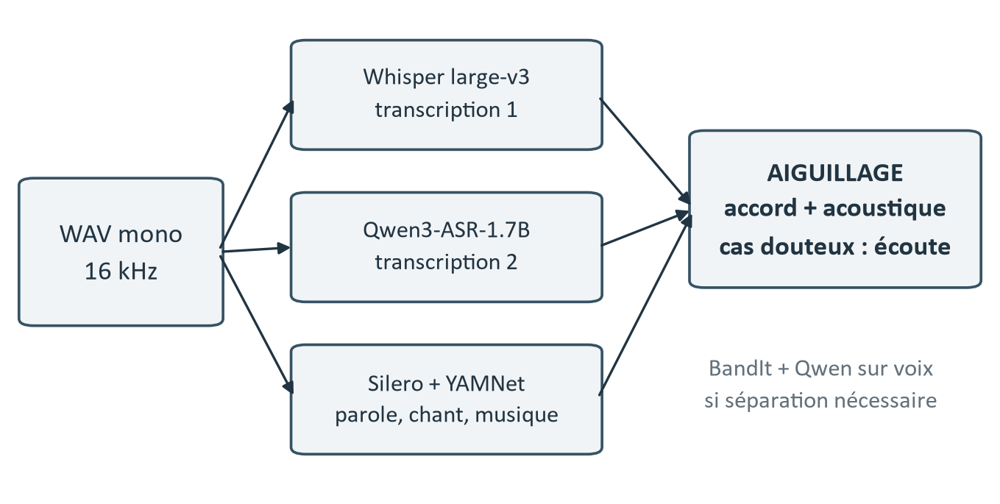
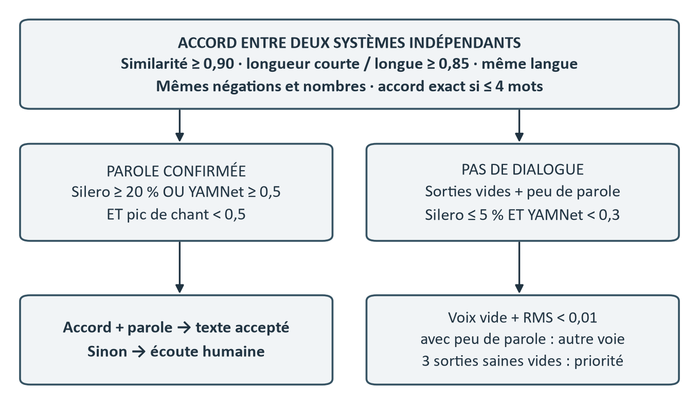

# Point 3 — Transcription vérifiée des dialogues

## En bref

```
 3 088 extraits audio
        │
        ├─ Whisper large-v3 ─┐
        │                    ├─> d'accord ? ── oui ──> texte accepté
        ├─ Qwen3-ASR ────────┘        │
        │                             non / musique / doute
        ├─ parole ? musique ?                 │
        │  (Silero VAD, YAMNet)               ▼
        │                         vérification à l'écoute (Label Studio)
        └─ voix séparée (BandIt)              │
           pour les cas difficiles            ▼
                                   nettoyage, langue ──> corpus.csv
```

| | |
|---|---|
| Extraits traités | 3 088 |
| Relus à la main | 1 032 |
| Avec dialogue anglais | 2 025 (66 %) |
| Sans dialogue | 994 |
| Autre langue / incertain | 67 / 2 |

Le résultat, `resultats/corpus.csv`, réunit pour chaque extrait la partition,
l'émotion, la description et le dialogue. C'est l'entrée de tous les modèles du point 4
(le texte l'utilise pour le dialogue, la vidéo et l'audio pour les identifiants et la partition).

## Schémas





Les règles exactes (similarité des mots ≥ 0,90, longueurs à 15 % près, mêmes négations et mêmes nombres,
parole confirmée par Silero ou YAMNet) et les raisons des 992 vérifications sont détaillées dans la
partie 4 du [rapport](../RAPPORT.pdf).

## Les étapes

| Script | Rôle | Sortie |
|---|---|---|
| `01_preparer_audio.py` | MP3 → WAV 16 kHz mono | `work/audio/` |
| `02_transcrire.py` | Whisper large-v3 et Qwen3-ASR-1.7B sur l'extrait complet | `work/asr/` |
| `03_detecter_sons.py` | Parole, musique, chant (Silero VAD, YAMNet) | `work/evidence/` |
| `04_separer_voix.py` | Extraits difficiles : voix séparée (BandIt) puis Qwen sur la voix seule | `work/recovery/` |
| `05_aiguiller.py` | Texte accepté, pas de dialogue, ou à vérifier | `resultats/aiguillage.jsonl` |
| `06_verification.py` | Vérification dans Label Studio (vidéo, audio, transcriptions) | `resultats/decisions_verification.jsonl` |
| `07_nettoyer.py` | Décisions appliquées, nettoyage léger, détection de la langue | `work/cleaned.jsonl` |
| `08_exporter.py` | Transcription finale | `resultats/transcriptions_verifiees.csv` |
| `09_construire_corpus.py` | Ajout de la partition, de l'émotion et de la description | `resultats/corpus.csv` |

`work/` est dans le dossier du corpus (fichiers lourds, non versionnés) ;
`resultats/` est versionné.

## Pourquoi ces choix

| Choix | Pourquoi |
|---|---|
| Deux modèles de transcription | Quand deux modèles indépendants donnent le même texte, il est probablement juste. Quand ils divergent, l'extrait part en vérification : on ne relit que ce qui est douteux. |
| Détection de la parole et de la musique | Sur un extrait sans parole, ou couvert par la musique, les modèles de transcription inventent du texte. Ces extraits sont repérés avant d'accepter une transcription. |
| Voix séparée seulement pour les cas difficiles | La séparation aide quand la musique couvre les dialogues, mais elle peut aussi abîmer une voix déjà claire. |
| Vérification à l'écoute | Écouter avec la vidéo est le seul moyen fiable de trancher entre deux transcriptions ou de dire qu'il n'y a pas de dialogue. |
| Dialogue anglais uniquement | Les modèles texte utilisés ensuite sont anglais. Les extraits dans une autre langue sont gardés sans dialogue. |

## Résultats détaillés

Décisions prises sur les 1 032 extraits relus :

| Décision | Extraits |
|---|---:|
| Texte de Qwen | 690 |
| Texte de Whisper | 234 |
| Pas de dialogue | 63 |
| Texte de Qwen sur la voix séparée | 28 |
| Texte corrigé à la main | 17 |

Répartition finale :

| Ensemble | Films | Extraits | Dialogue anglais |
|---|---:|---:|---:|
| train | 250 | 2 207 | 1 450 |
| dev | 50 | 442 | 298 |
| test | 50 | 439 | 277 |
| **total** | **350** | **3 088** | **2 025** |

Seul le dialogue anglais est gardé dans la colonne `dialogue` de `corpus.csv`.

## Premier essai : un seul modèle, avec ou sans séparation de la voix

Avant cette chaîne, nous avons essayé Whisper `large-v3-turbo` seul (détection de parole Silero VAD,
filtrage des segments douteux), sur l'audio brut et sur la voix isolée par Demucs, pour les 3 088 extraits :

| Traitement | Extraits avec parole | Mots par extrait parlé | Textes modifiés par rapport au brut |
|---|---:|---:|---:|
| Audio brut | 2 119 (68,6 %) | 14,9 | — |
| Voix isolée (Demucs) | 2 167 (70,2 %) | 14,8 | 1 332 (43,1 %) |
| Filtre passe-bande 300–3 400 Hz | 12 extraits testés : mêmes textes | — | — |

Demucs change 43 % des textes, mais sans transcription de référence on ne peut pas dire lesquels sont
meilleurs : il retrouve parfois un mot couvert par la musique et en déforme parfois un autre. Le filtre
fréquentiel ne change rien, car la musique occupe la même bande que la voix. D'où la chaîne retenue : deux
modèles indépendants qui se contrôlent, la séparation réservée aux cas difficiles, et une vérification à
l'écoute de tous les désaccords.

## Limites

- Seuls les extraits douteux ont été relus (1 032 sur 3 088) ; les autres
  transcriptions sont acceptées automatiquement et peuvent contenir des erreurs.
- Les cris, rires et pleurs ne sont pas des mots et ne sont pas transcrits,
  alors qu'ils portent beaucoup d'émotion.
- Un tiers des extraits n'a pas de dialogue anglais : le modèle texte doit
  s'appuyer aussi sur la description.

## Reproduire le corpus

Le corpus n'est pas versionné : par défaut, les scripts le cherchent dans l'archive du cours décompressée
à côté du dépôt (`../PROJET_SID_2026/PROJET_SID_2026/movie/`), sinon dans la variable d'environnement
`PROJET_SID_DIR` (dossier qui contient `movie/`).

À partir des résultats versionnés (quelques secondes, résultat identique) :

```powershell
cd point3_transcription
python 07_nettoyer.py
python 08_exporter.py
python 09_construire_corpus.py
```

Chaîne complète depuis `movie/` (environ 2 à 3 h sur GPU) :

```powershell
python 01_preparer_audio.py
python 02_transcrire.py
python 03_detecter_sons.py
python 04_separer_voix.py
python 05_aiguiller.py
python 06_verification.py preparer      # puis vérification dans Label Studio
python 06_verification.py lancer
python 06_verification.py exporter --input export_label_studio.json
python 07_nettoyer.py
python 08_exporter.py
python 09_construire_corpus.py
```

La vérification manuelle ne se refait pas : ses décisions sont gardées dans
`resultats/decisions_verification.jsonl` et réappliquées par `07_nettoyer.py`.
Whisper et Qwen ne sont pas parfaitement déterministes : une chaîne complète
peut aiguiller différemment quelques extraits, qui reprennent alors la proposition
automatique. `--limite 20` permet un essai rapide.

Réglages : `config/pipeline.json` ; chemins des modèles : `config/modeles.json`.

## Environnements

- `requirements.txt` : environnement principal.
- `requirements-dml.txt` : `.venv-dml` pour BandIt (onnxruntime-directml).
- `requirements-review.txt` : `.venv-review` pour Label Studio.
- `requirements-language.txt` : langid, installé dans `runtime/language_dependencies`.

Whisper et Qwen tournent avec whisper.cpp et llama.cpp (Vulkan).
