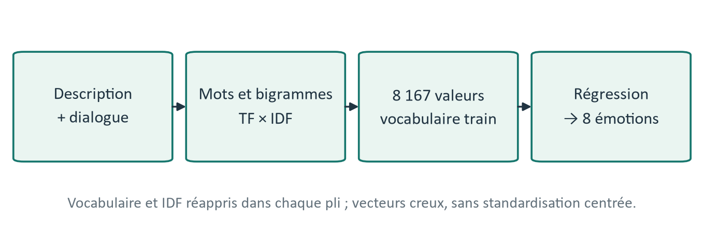
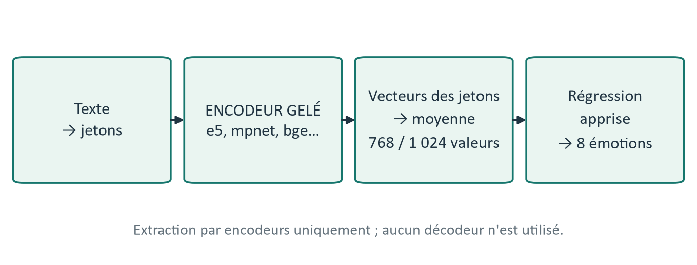
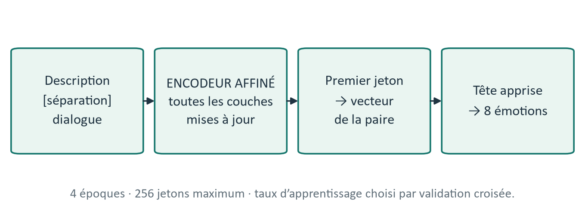

# Texte : reconnaître l'émotion à partir de la description et des dialogues

## En bref

```
                 ┌──> ekman fine-tuné ─────┐
                 ├──> e5 fine-tuné ────────┤
 description ────┤──> RoBERTa fine-tuné ───┤
     +           ├──> bge fine-tuné ───────┼──> moyenne des probabilités ──> 8 émotions
 dialogue ───────┤──> e5 (gelé) ───────────┤
                 └──> ekman (gelé) ────────┘
```

| Étape | Système | F1 cv | F1 dev | Exactitude dev |
|---|---|---|---|---|
| — | Hasard | — | 0,125 | 12,5 % |
| N1 | TF-IDF + régression logistique | 0,295 | 0,295 | 29,9 % |
| N2 | moyenne de 6 modèles (TF-IDF + 5 modèles gelés) | 0,352 | 0,366 | 36,7 % |
| **N3** | **moyenne de 6 modèles (4 fine-tunés + 2 gelés)** | **0,362** | **0,387** | **38,9 %** |

- Tous les choix sont faits par validation croisée sur train ; dev ne sert qu'à
  mesurer, test n'est pas utilisé.
- Les probabilités du système final sont dans `resultats/probas_texte.npz`.

## Schémas







La partie 6 du [rapport](../RAPPORT.pdf) détaille chaque niveau (TF-IDF, encodeurs, déroulé du fine-tuning),
les mots que le TF-IDF associe à chaque émotion et les matrices de confusion.

## Les données

Entrée : [point3_transcription/resultats/corpus.csv](../point3_transcription/resultats/corpus.csv),
une ligne par extrait (`caption`, `dialogue`, `a_dialogue`, `emotion`, `partition`).

| | train | dev | test |
|---|---|---|---|
| Films | 250 | 50 | 50 |
| Extraits | 2 207 | 442 | 439 |
| Avec dialogue anglais | 1 450 (66 %) | 298 (67 %) | 277 (63 %) |

La description fait 53 mots en moyenne, le dialogue 16. Un tiers des extraits
n'a pas de dialogue, et seulement 41 % des extraits `fear`.

## Comment on mesure

- Partition par film commune à tous les groupes (250 / 50 / 50).
- Validation croisée à 5 plis sur train, groupée par film : un film n'est jamais
  à la fois dans l'apprentissage et l'évaluation d'un pli. Elle sert à tous les
  choix : C, poids des classes, entrée, taux d'apprentissage, modèles fusionnés.
- Dev (50 films) est trop petit pour choisir : en choisissant sur dev, le système
  N2 affichait 0,405 sur dev, contre 0,366 une fois réglé en CV.
- F1 macro comme métrique principale, classes pondérées.
- Fusion ([04_texte_fusion_n2.py](04_texte_fusion_n2.py) pour N2,
  [06_texte_fusion_n3.py](06_texte_fusion_n3.py) pour N3) : les modèles sont classés par
  F1 en CV, puis on fait la moyenne des probabilités des k premiers ; k est choisi
  en CV. Rien n'est appris à cette étape.

## Étape 1 — N1 : TF-IDF

[02_texte_tfidf.py](02_texte_tfidf.py) : TF-IDF (mots et bigrammes) + régression
logistique ou SVM linéaire, sur la description, le dialogue ou les deux. Le
TF-IDF est réappris dans chaque pli.

| Entrée | Logistique (F1 cv) | SVM (F1 cv) |
|---|---|---|
| description | 0,286 | 0,282 |
| dialogue | 0,158 | 0,154 |
| description + dialogue | **0,295** | 0,287 |

## Étape 2 — N2 : modèles pré-entraînés gelés

[03_texte_embeddings.py](03_texte_embeddings.py) : chaque texte est transformé en
vecteur par un modèle pré-entraîné qui n'est pas modifié ; seule une régression
logistique est entraînée. Cinq modèles : trois encodeurs de phrases (mpnet,
e5-large, bge-large) et deux modèles déjà entraînés sur des émotions (goemotions,
ekman).

Quatre façons de donner le texte au modèle :
`description`, `dialogue`, `description+dialogue` (encodés séparément, vecteur
du dialogue à zéro s'il n'y en a pas, plus l'indicateur `a_dialogue`) et
`concatenation` (les deux textes bout à bout, un seul vecteur).

| Modèle | description | dialogue | description+dialogue | concaténation |
|---|---|---|---|---|
| e5 | 0,323 | 0,175 | 0,324 | **0,330** |
| ekman | 0,319 | 0,172 | **0,321** | 0,313 |
| mpnet | 0,314 | 0,169 | **0,320** | 0,308 |
| bge | 0,313 | 0,176 | **0,315** | 0,313 |
| goemotions | **0,299** | 0,169 | 0,295 | 0,288 |

(F1 cv ; en gras l'entrée retenue pour chaque modèle.)

**Système N2** (`04_texte_fusion_n2.py`) : la fusion retient les 6 modèles disponibles (les 5 modèles gelés
et le TF-IDF). F1 cv 0,352, dev 0,366, exactitude 36,7 %. Sur dev, le gain sur le
meilleur modèle seul n'est pas significatif (IC 95 % par films : [−0,012 ; +0,063]).

Ce qu'on retient à ce stade :

- Les modèles pré-entraînés dépassent le TF-IDF, jusqu'à 3,5 points en CV (e5) : ils
  connaissent les synonymes et le contexte, le TF-IDF doit tout apprendre sur 2 200 extraits.
- Le dialogue seul est faible (F1 ≈ 0,17). Ajouté à la description, il aide un
  peu en CV (jusqu'à +0,6 point) et davantage sur dev (mpnet : 0,312 → 0,358).
- Encoder description et dialogue séparément est un peu meilleur que les
  concaténer pour 4 modèles sur 5 (jusqu'à +1,2 point en CV).

## Étape 3 — N3 : fine-tuning

[05_texte_finetuning.py](05_texte_finetuning.py) : cette fois tout le modèle est
mis à jour sur nos données, avec une nouvelle couche de sortie à 8 classes.
Description et dialogue sont donnés comme une paire de textes. On affine les
5 modèles de N2 et RoBERTa-large (même architecture qu'ekman, sans
pré-entraînement sur les émotions).

Réglages communs : 4 époques, lots de 16, 256 tokens. Le taux d'apprentissage
est choisi parmi {1e-5, 2e-5, 3e-5}, valeurs recommandées pour BERT et RoBERTa
(Devlin et al., 2019 ; Liu et al., 2019) : chaque taux a sa propre validation
croisée à 5 plis, le meilleur sert au modèle final.

| Modèle | lr 1e-5 | lr 2e-5 | lr 3e-5 | Gelé (N2) | F1 dev |
|---|---|---|---|---|---|
| ekman (RoBERTa-large, émotions) | 0,320 | 0,335 | **0,341** | 0,322 | 0,352 |
| e5-large | 0,315 | 0,318 | **0,335** | 0,330 | 0,339 |
| RoBERTa-large | **0,331** | 0,310 | 0,270 | — | 0,368 |
| bge-large | 0,318 | **0,323** | 0,313 | 0,315 | 0,370 |
| goemotions (RoBERTa-base) | 0,260 | 0,292 | **0,297** | 0,299 | 0,323 |
| mpnet (base) | 0,278 | **0,290** | 0,288 | 0,320 | 0,292 |

(F1 cv par taux ; en gras le taux retenu. F1 dev du modèle final.)

**Système N3** (`06_texte_fusion_n3.py`) : la fusion porte maintenant sur les modèles de N1, N2 et N3. Elle
retient 6 modèles : ekman, e5, RoBERTa et bge fine-tunés, plus e5 et ekman gelés.
F1 cv 0,362, dev 0,387, exactitude 38,9 %. Le gain sur le meilleur modèle seul
devient significatif sur dev (IC 95 % par films : [+0,003 ; +0,066]).

| k (modèles moyennés) | 1 | 3 | 5 | **6** | 7 | 9 | 12 |
|---|---|---|---|---|---|---|---|
| F1 cv | 0,341 | 0,353 | 0,358 | **0,362** | 0,361 | 0,360 | 0,348 |

Ce qu'on retient :

- Le fine-tuning aide les grands modèles (ekman +1,9 point, bge +0,8, e5 +0,5 en CV)
  mais pas les petits : mpnet perd 3 points par rapport à sa version gelée.
- Le taux d'apprentissage compte : RoBERTa-large passe de 0,331 à 0,270 entre
  1e-5 et 3e-5 ; un taux fixe aurait faussé la comparaison.
- Un pré-entraînement sur des émotions semble aider : ekman dépasse RoBERTa-large
  d'un point en CV.
- La fusion progresse surtout parce que les modèles affinés font des erreurs
  différentes : leur moyenne se compense mieux que celle de modèles gelés proches.
  En n'affinant qu'ekman, la fusion restait à 0,351 en CV.
- `awe`, `excitement` et `contentment` restent les plus confondues : la
  description dit ce qui se passe, rarement ce qu'on ressent.

## Lancer les scripts

```bash
pip install -r requirements.txt
python 01_explorer_corpus.py      # statistiques du corpus
python 02_texte_tfidf.py          # N1, ~1 min
python 03_texte_embeddings.py     # N2, ~3 min avec carte graphique
python 04_texte_fusion_n2.py      # fusion N2
python 05_texte_finetuning.py     # N3, ~3 h 30 avec carte graphique (6 modèles × 3 taux × 5 plis)
python 06_texte_fusion_n3.py      # fusion N3, système final
```

`requirements.txt` installe PyTorch pour CPU ; la carte graphique est utilisée
automatiquement si PyTorch en voit une (CUDA ou ROCm). Les modèles sont
téléchargés depuis Hugging Face au premier lancement, les vecteurs sont gardés
dans `data/` (non versionné). `05_texte_finetuning.py` enregistre chaque modèle
dès qu'il est fini et saute ceux déjà présents dans `scores_finetuning.csv` :
on peut l'interrompre et le relancer.

## Fichiers produits

Dans `resultats/` :

- `scores_tfidf.csv`, `scores_embeddings.csv`, `scores_finetuning.csv`,
  `scores_fusion_n2.csv`, `scores_fusion_n3.csv` ;
- `confusion_<modèle>.png` : matrices de confusion sur dev ;
- `probas_<modèle>.npz`, dont `probas_texte_n2.npz` (système N2) et
  `probas_texte.npz` (système final, N3).
  Champs : `video_id`, `partition`, `probabilites` (3 088 × 8, tous les extraits),
  `probabilites_hors_pli` (CV sur train, NaN ailleurs) et `emotions` : amusement,
  anger, awe, contentment, disgust, excitement, fear, sadness.
