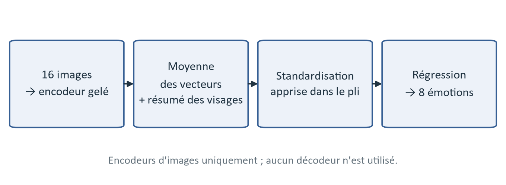
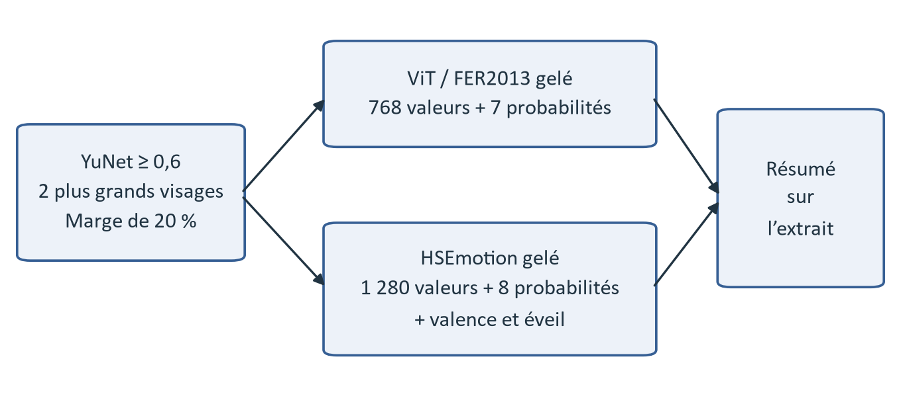

# Vidéo : reconnaître l'émotion à partir des images et des visages

## En bref

```
                    ┌──> PE + régression logistique ─────┐
                    ├──> PE + attention ─────────────────┤
 16 images          ├──> SigLIP 2 + attention ────────────┤
     +       ───────┤                                    ├──> moyenne des probabilités ──> 8 émotions
 visages            ├──> SigLIP 2 + régression logistique ┤
                    ├──> CLIP-B + régression logistique ─┤
                    └──> CLIP-H + régression logistique ─┘
```

| Étape | Système | F1 cv | F1 dev | Exactitude dev |
|---|---|---|---|---|
| N1 | couleurs et mouvement simple + régression logistique | 0,192 | 0,200 | 20,8 % |
| N2 | PE gelé + visages + régression logistique | 0,430 | 0,441 | 44,1 % |
| N3 | PE gelé + visages + tête d'attention | 0,421 | 0,454 | 45,2 % |
| **Final** | **moyenne de 6 modèles de N2 et N3** | **0,450** | **0,461** | **45,7 %** |

- Les choix automatiques sont faits par validation croisée sur train ; dev sert
  à mesurer les modèles retenus. Les tableaux ci-dessous portent sur CV et dev.
- Les encodeurs restent gelés, y compris en N3 : cette étape apprend une tête
  d'attention, sans modifier les poids des encodeurs d'images.
- Les probabilités finales sont dans `resultats/probas_video.npz`.

## Schémas





La tête d'attention du N3 est la même que celle de l'audio (schéma `rapport/figures/schema_n3_attention.png`).
La partie 7 du [rapport](../RAPPORT.pdf) détaille l'extraction des images, l'importance des descripteurs du
N1, les sept encodeurs, les visages et les matrices de confusion.

## Les données

Entrées : les vidéos de `movie/video/` et
[point3_transcription/resultats/corpus.csv](../point3_transcription/resultats/corpus.csv),
qui fournit les identifiants, l'émotion et la partition. Les descriptions et les
dialogues ne sont pas utilisés dans ce module.

| | train | dev | test |
|---|---|---|---|
| Films | 250 | 50 | 50 |
| Extraits | 2 207 | 442 | 439 |

Le chemin vers `movie/` se règle dans [config.py](config.py), ou avec
`EMOVID_DIR`. Les vidéos d'origine restent inchangées ; les images et les
vecteurs intermédiaires sont gardés dans `data/`, non versionné.

## Comment on mesure

- Partition par film commune aux autres modalités ; aucun film ne traverse les
  ensembles train, dev et test.
- Validation croisée à 5 plis sur train, groupée par film. La standardisation et
  les classifieurs sont réappris sur la partie d'apprentissage de chaque pli.
- F1 macro comme métrique principale, pour donner le même poids aux huit émotions.
- Dans `05`, les réglages sont comparés par la moyenne des F1 des cinq plis.
  Le SVM est aussi évalué après calibration : c'est la classe de probabilité
  maximale qui est comparée aux autres classifieurs (`f1_cv_probas`).
- Dans `07`, le classement et le choix du nombre de modèles utilisent le F1
  calculé sur l'ensemble des prédictions hors pli de train.

Dans les tableaux de ce README, **F1 cv désigne le F1 des prédictions hors pli
regroupées**, comme dans `07`. Il peut donc différer légèrement de la moyenne
par pli des fichiers `scores_n1.csv`, `scores_n2.csv` et `scores_n3.csv` : pour
PE en N2, on obtient 0,430 contre 0,427. Le F1 n'est pas une mesure additive.

Les scores de CV servent aussi à choisir les réglages et la fusion ; ils ne
constituent pas une estimation par validation croisée imbriquée. Le gain sur
dev est accompagné d'un intervalle obtenu par rééchantillonnage des films.

## Préparer les images

[00_nettoyer_pub.py](00_nettoyer_pub.py) repère les écrans de fin de la chaîne
Movieclips : bandeau gris foncé à gauche, bouton bleu à droite, présence continue
jusqu'à la dernière image et ressemblance avec deux bandeaux de référence.
Il produit `resultats/fin_pub.csv`, avec l'instant `fin_utile` où arrêter la
sélection des images. Les étiquettes d'émotion ne servent pas à cette détection.
Un écran de fin est repéré dans 33 extraits sur 3 088.

[01_extraire_images.py](01_extraire_images.py) prend ensuite 16 images, aux
milieux de 16 intervalles égaux sur la partie utile. Elles sont conservées en
couleur, sans recadrage, avec une largeur maximale de 640 pixels. Chaque
encodeur applique ensuite son propre prétraitement.

## Étape 1 — N1 : descripteurs simples

[04_video_n1.py](04_video_n1.py) calcule les moyennes et écarts-types de teinte,
saturation et luminosité, un histogramme HSV et la variation de luminosité entre
images consécutives. Les moyennes et écarts-types sur les 16 images donnent
270 caractéristiques par extrait.

Après standardisation, une régression logistique prédit les huit émotions.
Le coefficient de régularisation et la pondération des classes sont choisis
en CV. Réglage retenu : `C = 0.0003`, classes équilibrées.

F1 cv 0,192, dev 0,200 : les couleurs et la variation entre images donnent une
base de comparaison, mais décrivent peu le contenu émotionnel de la scène.

## Étape 2 — N2 : encodeurs gelés et visages

[02_encodeurs.py](02_encodeurs.py) transforme les images en vecteurs, sans
utiliser les étiquettes ni entraîner les encodeurs.

| Encodeur | Modèle | Information représentée |
|---|---|---|
| CLIP-B | `openai/clip-vit-base-patch16` | image-texte |
| CLIP-L | `openai/clip-vit-large-patch14` | image-texte, modèle plus grand |
| CLIP-H | `laion/CLIP-ViT-H-14-laion2B-s32B-b79K` | image-texte, autre pré-entraînement |
| SigLIP 2 | `google/siglip2-so400m-patch14-384` | image-texte |
| PE | `timm/PE-Core-L-14-336` | image-texte |
| DINOv2 | `facebook/dinov2-base` | images seules |
| VideoMAE | `MCG-NJU/videomae-base-finetuned-kinetics` | les 16 images ensemble |

Les six premiers donnent un vecteur par image ; VideoMAE donne un vecteur par
extrait. Les vecteurs sont gardés en float16 dans `data/emb_<encodeur>.npy`.

[03_visages.py](03_visages.py) détecte les visages avec YuNet sur les mêmes
16 images et conserve les deux plus grands par image. Chaque visage est découpé
avec une marge de 20 %, puis traité par deux modèles gelés :

- `vit` : ViT entraîné sur FER2013, vecteur de 768 dimensions et probabilités
  de 7 expressions ;
- `hse` : HSEmotion EfficientNet-B0 entraîné sur AffectNet, vecteur de
  1 280 dimensions, probabilités de 8 expressions, valence et éveil.

Les résultats sont conservés par image et par visage dans `data/visages.npz`.
Au moins un visage est détecté dans 2 849 extraits ; 77 % des images contiennent
un visage. Les emplacements sans visage sont masqués. Les expressions servent
de caractéristiques : le classifieur apprend leur lien avec les huit émotions,
sans correspondance manuelle entre catégories.

[05_video_n2.py](05_video_n2.py) compare progressivement :

1. 4, 8 ou 16 images de scène, regroupées par moyenne ou moyenne + écart-type ;
2. les visages : aucun, ViT, HSEmotion ou les deux, résumés sur les 16 images ;
3. régression logistique, analyse discriminante avec rétrécissement et SVM RBF ;
4. les visages seuls, avec les trois classifieurs.

La régression logistique utilise une grille de `C` entre 0,00001 et 0,1, avec
ou sans pondération des classes. Le SVM utilise 25 essais Optuna pour `C` et
`gamma`, puis une calibration sigmoïde. Au total, 123 configurations sont
enregistrées. La régression logistique est retenue pour les huit sorties.

| Sortie retenue | Images de scène | Visages | F1 cv | F1 dev |
|---|---|---|---|---|
| PE | 16 | ViT + HSE | **0,430** | **0,441** |
| SigLIP 2 | 16 | ViT | 0,408 | 0,415 |
| CLIP-B | 8 | ViT | 0,406 | 0,417 |
| CLIP-H | 16 | HSE | 0,405 | 0,417 |
| CLIP-L | 16 | ViT | 0,401 | 0,423 |
| DINOv2 | 4 | HSE | 0,373 | 0,399 |
| VideoMAE | 16, un vecteur par extrait | ViT + HSE | 0,358 | 0,404 |
| Visages seuls | — | ViT | 0,304 | 0,321 |

La moyenne simple des vecteurs de scène est retenue dans chaque cas. PE est le
meilleur modèle seul. Les visages seuls sont moins performants, mais les
configurations retenues les associent toutes aux vecteurs de scène.

## Étape 3 — N3 : apprendre une tête d'attention

[06_video_n3.py](06_video_n3.py) apprend un poids pour chacune des 16 images.
Chaque entrée réunit le vecteur de scène et les caractéristiques du plus grand
visage de l'image. Une projection linéaire, GELU et dropout précèdent la moyenne
pondérée par attention, puis une couche de sortie prédit les huit émotions.

L'entraînement utilise AdamW et une entropie croisée pondérée par classe. Des
images sont retirées au hasard pendant l'apprentissage. Pour chacun des six
encodeurs d'images, 30 essais Optuna choisissent les visages, la dimension cachée,
le dropout, le taux d'apprentissage, la régularisation, les époques et la part
d'images retirées. Les essais utilisent une graine ; le réglage retenu est ensuite
réévalué en CV et entraîné sur tout train avec trois graines, dont les
probabilités sont moyennées. Le nombre d'époques est fixé, sans arrêt précoce
sur le pli de validation.

| Encodeur | N2 : moyenne + classifieur | N3 : attention | F1 dev de N3 |
|---|---|---|---|
| PE | **0,430** | 0,421 | 0,454 |
| SigLIP 2 | 0,408 | **0,419** | 0,428 |
| CLIP-L | 0,401 | 0,401 | 0,422 |
| CLIP-H | **0,405** | 0,395 | 0,444 |
| CLIP-B | **0,406** | 0,393 | 0,380 |
| DINOv2 | **0,373** | 0,369 | 0,395 |

(F1 cv dans les deux colonnes centrales.)

L'attention n'améliore pas systématiquement le modèle seul : SigLIP 2 progresse,
PE recule et CLIP-L reste au même niveau. Sur des extraits courts et avec
2 207 exemples d'apprentissage, ajouter une tête entraînable ne garantit donc
pas un gain. Ces sorties restent des candidates pour la fusion.

## Système final — fusion des modèles vidéo

[07_video_fusion.py](07_video_fusion.py) classe les 15 sorties disponibles :
N1, les huit modèles N2 et les six têtes N3. Il moyenne les probabilités des
`k` premiers, pour `k` de 1 à 15, puis retient le meilleur F1 hors pli sur train.
Les modèles finaux sont entraînés sur train uniquement.

| k | 1 | 3 | 5 | **6** | 7 | 10 | 15 |
|---|---|---|---|---|---|---|---|
| F1 cv | 0,430 | 0,439 | 0,441 | **0,450** | 0,445 | 0,447 | 0,444 |

Les six membres retenus sont PE, SigLIP 2, CLIP-B et CLIP-H avec régression
logistique, plus PE et SigLIP 2 avec attention. Ils partagent les vecteurs de
quatre encodeurs de scène et les caractéristiques des visages.

F1 cv 0,450, dev 0,461, exactitude dev 45,7 %. Sur dev, le gain par rapport au
meilleur modèle seul n'est pas significatif : IC 95 % par films
[−0,008 ; +0,047], avec 2 000 rééchantillonnages. La présence de deux têtes
d'attention dans la combinaison retenue ne prouve pas un gain général de cette
architecture ; elle reflète le choix effectué sur les probabilités hors pli.

## Lancer les scripts

Utiliser un environnement avec PyTorch, torchvision et les dépendances de
[requirements.txt](requirements.txt), dont Optuna pour `05` et `06`.
Pour `emotiefflib`, seule la partie PyTorch est utilisée ; l'installation avec
`python -m pip install --no-deps emotiefflib==1.1.1` évite d'ajouter ses autres
moteurs d'inférence. Conserver les versions de PyTorch et torchvision adaptées
à la carte graphique si l'environnement GPU est déjà configuré.

Depuis `point4_video/`, après avoir réglé `EMOVID_DIR` vers le dossier `movie/` :

```bash
python 00_nettoyer_pub.py        # instants de fin utile
python 01_extraire_images.py     # 16 images par extrait
python 02_encodeurs.py           # vecteurs des 7 encodeurs
python 03_visages.py             # détection et caractéristiques des visages
python 04_video_n1.py            # N1
python 05_video_n2.py            # N2 : configurations et classifieurs
python 06_video_n3.py            # N3 : têtes d'attention
python 07_video_fusion.py        # système final
```

Les encodeurs et les têtes PyTorch utilisent automatiquement le GPU s'il est
disponible, sinon le CPU. YuNet et les classifieurs scikit-learn utilisent le
CPU. Les modèles pré-entraînés sont téléchargés au premier lancement.

Les scripts `01` et `02` réutilisent les images et les vecteurs déjà présents.
`05` reprend les configurations de son CSV et `06` saute les encodeurs déjà
terminés. Après avoir changé les paramètres d'une expérience, son cache ou sa
ligne de résultats doit être renouvelé avant de relancer les étapes suivantes.

## Fichiers produits

Dans `data/` : images, vecteurs de scène, caractéristiques N1 et visages ; ce
sont des caches régénérables, exclus de Git.

Dans `resultats/` :

- `fin_pub.csv` : fin utile de chaque vidéo ;
- `scores_n1.csv`, `scores_n2.csv`, `scores_n3.csv` et
  `essais_n3_<encodeur>.csv` : réglages et résultats des expériences ;
- `scores_fusion_video.csv` : comparaison des nombres de modèles moyennés ;
- `confusion_<modèle>.png` : matrices de confusion sur dev ;
- `probas_<modèle>.npz`, dont **`probas_video.npz`**, pour la fusion des modalités.

Les NPZ contiennent `video_id`, `partition`, `probabilites` (3 088 × 8),
`probabilites_hors_pli` (prédictions de train, NaN ailleurs) et `emotions` dans
l'ordre : amusement, anger, awe, contentment, disgust, excitement, fear, sadness.

Les scripts conservent les vecteurs et les probabilités, mais n'exportent pas
les poids des classifieurs et des têtes entraînées. Prédire une vidéo extérieure
au corpus demande donc de préparer leur export et une chaîne d'inférence.
